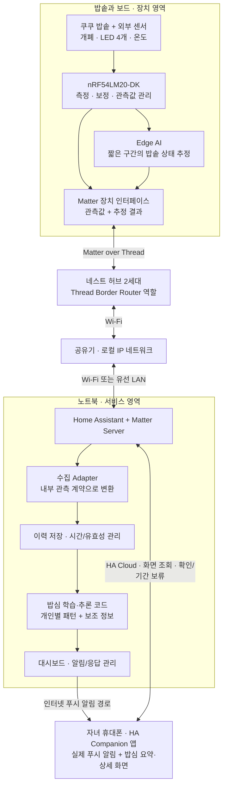
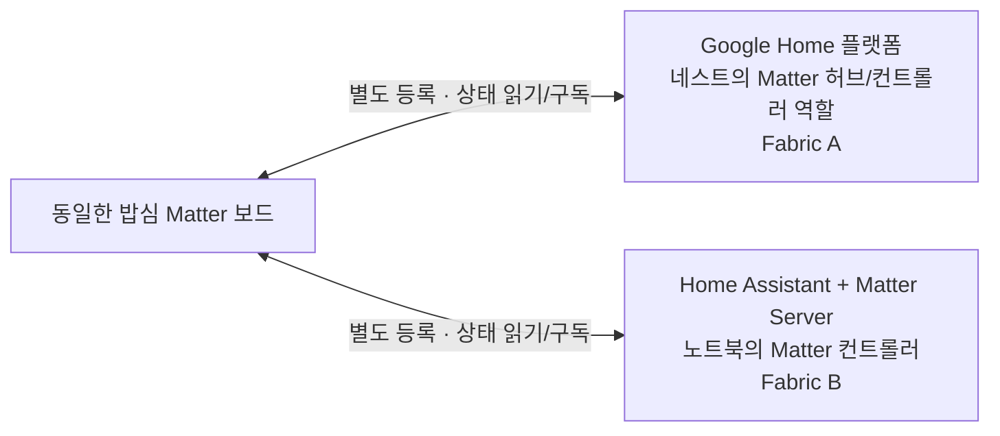
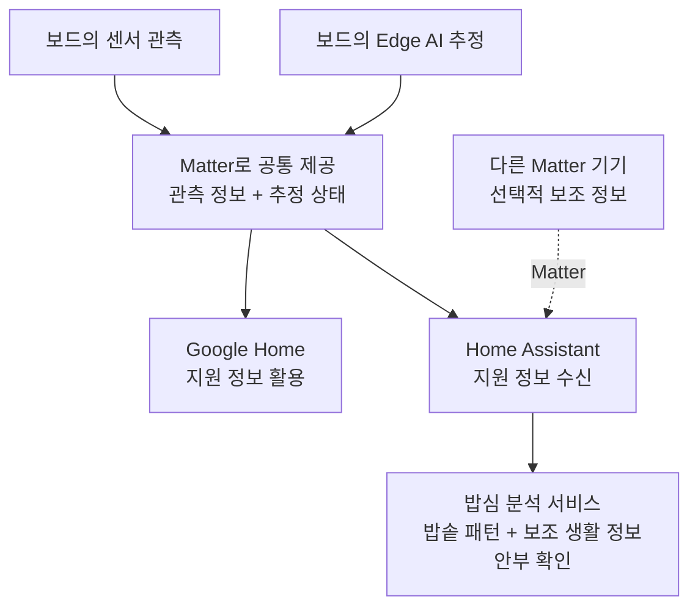
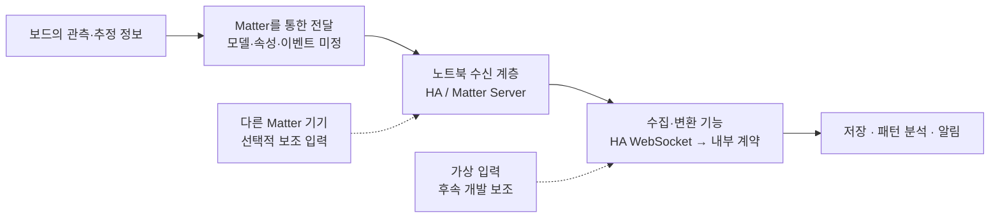

# 시스템 아키텍처

작성일: 2026-10-02 · 용도: 사용자 결정에 따른 시스템 아키텍처 공유

> 이 아키텍처는 사용자가 정한 방향으로 진행한다. 팀의 별도 아키텍처 합의를 기다리는 문서가 아니라, 구현할 구조를 공유하는 기준 문서다. 역할 분담은 별도 문서에서 다루며, 하드웨어 상세는 검증 대상이며 데이터 형식·정책은 연결된 상세 설계 문서를 따른다. 구조의 결정과 실제 구현 완료는 구분한다.

## 1. 아키텍처 기준과 범위

밥심은 밥솥에서 밥을 꺼내 먹는 독거노인의 사용 관련 행동을 관측하고, 평소 패턴과 다른 변화가 있으면 자녀의 안부 확인을 돕는다. 소분·냉동 보관을 주로 하는 생활 방식은 이번 대상에서 제외한다. 뚜껑 개방을 식사 완료로, 사용 감소를 건강 이상으로 단정하지 않는다.

| 항목 | 현재 기준 |
|---|---|
| 확보·구매 장비 | 쿠쿠 CRP-G1020MP, nRF54LM20-DK, 구글 네스트 허브 2세대 |
| 센서 | 자석 개폐센서, NTC 온도센서, 광센서 5개 구매. 광센서 4개 사용 계획, 1개 예비 |
| 배송 | 센서 2026-10-06 발송 예정. 수령일 미확정 |
| 물리적 연결 | 보드 ↔ Thread ↔ 네스트 ↔ Wi-Fi ↔ 공유기 ↔ Wi-Fi 또는 LAN ↔ 노트북 |
| Edge AI | 고득점을 위한 핵심 설계 목표로 포함. 모델·분류 상태·SDK·NPU 사용 여부는 미정 |
| Multi-Admin | 같은 보드를 Google Home과 HA에 각각 등록하는 것을 핵심 설계 목표로 포함 |
| 정보 제공과 서비스 | 보드의 관측·추정 정보를 Matter로 공통 제공하고, 밥심은 그 이력으로 패턴 분석 서비스를 구성. 구체적인 형식은 상세 계약 문서에서 관리 |
| 서비스 | 노트북에서 수집·저장·개인별 패턴 분석. 자녀 휴대폰의 기존 HA Companion 앱에서 밥심 화면·푸시 알림 제공 |
| 개인화 | 일반 초기 기준 + 선택적 생활 습관 입력 → 약 일주일 초기 학습 → 이후 지속 보정. 반복 개방은 우선 규칙으로 묶음 |
| 다른 기기와 연계 | 보조 정보 결합 구조는 유지하되 이번에는 가상 입력만 사용. 실제 추가 기기 없음 |

Edge AI와 Multi-Admin은 현재 목표 범위에 포함한다. 구체적인 모델과 전송 매핑이 확정되었다는 뜻은 아니다. 기존 인계 문서의 ‘네트워크 장비 미확정’ 기록은 네스트 구매 사실로 갱신하여 해석한다.

### 광센서 관측 대상

광센서 5개 중 **열림/잠김·보온·백미 표시등에 3개, 상단 시간 표시부 맨 왼쪽 LED에 1개**를 사용하고 1개를 예비로 둔다. 상단 LED는 ‘예약 2시간 / 찜 10분’ 표기를 공유한다. 구매 수량 증가는 없으며 부착 계획을 추가한 것이다.

사용자가 첨부한 설명서 17쪽 화면에는 예약설정 시간이 **예약 취사 완료까지 남은 시간**이라고 적혀 있다. 예약 취소까지 남은 시간이 아니다. 이 센서는 해당 LED의 점등·점멸을 관측하는 보조 입력이며, LED 하나로 전체 남은 시간이나 예약 여부를 확정하지 않는다. 소등도 예약 없음으로 단정하지 않는다. 다른 표시등·온도·시간 흐름과 함께 해석한다. 표시부의 실제 동작 및 확정 밥솥과 설명서의 대응은 아직 검증 전이다.

야간 예약 취사 등을 고려하여 취사 완료 직후 개방을 일률적으로 기대하지 않고, 평소 집에서 밥솥의 밥을 꺼내 먹는 시간과 비교한다. 초기 개인화에는 그 시간대와 요일별로 다른 생활 습관을 선택적으로 입력받고, 기록이 쌓이면 보정한다. 입력 형식과 판단 기준은 상세 계약·분석 정책 문서에서 관리한다.

## 2. 실제 장비와 통신 경로

**노트북이 Thread를 직접 수신하지 못하므로 네스트의 Thread Border Router를 거쳐 보드와 통신한다. Multi-Admin을 추가해도 이 경로는 유지된다.**

이 그림은 밥심 장치에서 HA까지의 기본 물리 경로와 서비스 흐름이다. 다른 Matter 기기의 선택적 입력은 5절에서 별도로 표시한다. 보드와 HA가 무선으로 직접 연결되는 구조가 아니다. 네스트는 HA로 향하는 Matter 통신을 전달하며, 분석용 내부 정보로의 변환은 노트북의 수집 프로그램이 담당한다.

### HA 서버·밥심 코드·휴대폰 앱의 관계

HA 서버와 Matter Server는 A의 노트북 환경에서 기기 정보를 수신한다. B가 만드는 밥심 코드가 기록 정리·학습·추론·알림 판단을 담당한다. 코드의 실행 위치는 A의 노트북이며, HA와 연동하는 별도 서비스로 제공한다. HA가 학습 모델이나 밥심 판단을 자동 생성하는 구조는 아니다.

화면과 알림 전달에는 기존 HA 대시보드·Companion 앱 기능을 활용한다. 대시보드는 노트북 전용 화면이 아니라 자녀 휴대폰 앱에서도 보는 밥심 화면이다. 별도 앱 개발은 기본 범위가 아니지만 화면 구성과 분석 결과 연결은 구현해야 한다.

휴대폰 푸시 수신과 상세 화면 접속은 별도 경로다. 외부망에서 실제 폰 알림을 받고 화면을 열 수 있도록 구성한다. 원격 접속은 HA Cloud 무료 체험을 사용하며, 노트북 표시만으로 최종 서비스를 대체하지 않는다.

## 3. Multi-Admin: 같은 보드를 두 플랫폼에 등록

다음 그림은 **기기 등록과 접근 관계**다. 화살표가 물리적 직결을 뜻하지 않으며, HA 통신은 위 그림의 네스트·공유기 경로를 이용한다.

| 네스트 한 대의 역할 | 의미 |
|---|---|
| Thread Border Router | Thread 보드와 집 안 IP 네트워크를 연결. 원래 설계부터 필요한 역할 |
| Google Home의 Matter 허브 | Google Home에 등록한 보드의 상태를 이용. Multi-Admin 목표에서 함께 활용하는 역할 |

등록 관계를 이해하기 위한 예시이며, 실제 절차와 담당은 후속 설계에서 정한다:

1. 보드를 Google Home에 Matter 기기로 등록한다.
2. 기기 공유 절차로 같은 보드를 HA에도 등록한다. HA에서 시작하여 Google Home에 공유하는 순서도 가능하다.
3. Google Home과 HA가 각각 보드의 상태를 읽고 변경 보고를 받는다.

등록 대상은 **센서값이 아니라 기기**다. 네스트에 값이 도착하면 자동으로 두 플랫폼에 등록되거나 복제되는 것이 아니다. 두 플랫폼은 각각 등록 관계와 접근 권한을 가진다. HA 화면을 Google에 단순 연동하는 방식도 이 Multi-Admin 목표와 구분한다.

Google Home 앱·네스트 화면에 어떤 정보가 표시되는지는 플랫폼 지원 범위에 따라 달라진다. 이 구조는 두 플랫폼에 동일한 화면이 제공된다는 뜻은 아니다.

## 4. Edge AI와 노트북 분석의 분업

**보드는 ‘지금 밥솥의 상태’를 추정하고, 노트북은 ‘평소 대비 사용 패턴의 변화’를 판단한다.**

| 구분 | 보드 Edge AI | 노트북 밥심 분석 |
|---|---|---|
| 입력 | 최근 온도·LED·개폐의 시간 흐름 | 관측 이력, 보드 추정 이력, 개인별 기준선, 가용한 다른 기기의 보조 정보 |
| 시간 범위 | 수초~수분 후보. 길이 미정 | 수시간~수일 이상. 기준선 기간 미정 |
| 출력 | 밥솥 상태 추정 또는 판단 불가 | 사용 감소·지연, 안부 확인 필요 여부 |
| 예시 | 메뉴 선택과 실제 가열 상태 구분 | 평소 대비 개방 횟수 감소 판단 |
| 책임 영역 | 보드에서 센서 정보를 해석하는 기능 | 기록을 이용해 사용 패턴을 해석하는 기능 |

취사·보온 등의 분류 목록은 후보이며 센서로 구분 가능한지 검증할 대상이다. 모델 학습은 노트북 등에서, 추론은 보드에서 실행할 수 있다. 모델 종류·메모리·SDK·NPU 사용 여부는 미정이다.

반복 개방은 우선 규칙으로 묶고, 사람마다 다른 사용 시간·간격·요일별 패턴은 학습한다. 일반 초기 기준과 선택 입력에서 출발해 약 일주일을 초기 관측·학습 구간으로 두고 계속 보정한다. 이는 일주일 뒤 학습이 완성된다는 보장이 아니다. 학습 결과와 알림 발송 정책은 분리한다. 규칙적인 사용은 두 예상 창의 연속 미관측으로 첫 안내 후보를 만들며 상세 정책은 최종 합의 문서를 따른다.

AI 결과와 원래 관측값을 함께 유지한다. AI가 판단하지 못할 때도 기본 관측 흐름은 유지되어야 한다. 보드의 상태 추정 결과는 노트북의 사용 이력 해석에 활용하며, 보호자 알림에 필요한 장기 패턴 판단은 노트북에 둔다.

## 5. Matter로 제공할 관측·추정 정보와 밥심 분석 서비스

**센서 관측값과 보드의 추정 상태를 모두 다른 플랫폼에서도 활용할 수 있도록 Matter로 제공하는 것이 설계 목표다.** 밥심의 차별성은 이 정보를 축적하여 개인별 패턴을 분석하고 보호자의 안부 확인으로 연결하는 서비스에 둔다.

| 계층 | 정보 또는 기능 | 아키텍처에서의 위치 |
|---|---|---|
| 관측 정보 | 뚜껑 개폐, 설치 지점 온도, LED 점등 등 | 보드에서 생성하여 Matter로 제공 |
| 추정 정보 | Edge AI가 판단한 밥솥 상태 등 | 보드에서 생성하여 관측 정보와 함께 Matter로 제공 |
| 플랫폼 활용 | 기기 등록, 상태 읽기·구독, 지원되는 표시·자동화 | Google Home과 HA가 각각 같은 기기에 접근 |
| 밥심 분석 서비스 | 이력 축적, 개인 기준선, 사용 패턴 변화 판단, 보호자 알림 | 노트북에서 실행하며 HA와 연결 |

이 그림은 정보의 활용 관계다. 밥심 보드의 실제 통신은 2절의 네스트 경로를 따른다. 보조 기기는 선택한 제품의 Thread 또는 Wi-Fi 등 연결 방식에 맞춰 HA에 연결한다. 다른 플랫폼이나 개발자도 제공된 정보를 활용해 별도의 분석 서비스를 만들 수 있다. 밥심만 정보를 해석할 수 있도록 제한하는 구조가 아니다.

표현 방식은 기존 Matter 표준을 우선한다. 기존 표준으로 의미를 정확히 표현하기 어려운 정보는 확장 모델을 검토하고, 다른 구현에서도 재사용할 수 있도록 정의를 문서화하는 방향이다. 전달 항목과 내부 형식은 상세 계약 문서에서 관리하며 실제 Matter/HA 매핑은 기술 확인 대상이다.

**공통으로 제공하려는 목표와 플랫폼이 기본적으로 이해·표시하는 범위는 구분한다.** 확장 모델이 필요하다면 HA 측 읽기·구독과 수집 코드도 함께 설계해야 한다. Google Home이 새로운 상태를 자동으로 이해한다고 가정하지 않는다. 이것은 플랫폼 지원의 차이이며, 일부 정보를 밥심에만 제공한다는 뜻이 아니다.

밥솥의 관측·추정 정보를 재사용 가능한 Matter 데이터 모델로 구성하는 것도 프로젝트의 기여 방향이다. 자체 확장 모델의 설계·공개와 공식 Matter 표준 채택은 구분한다. 특정 버전에 전용 밥솥 모델이 없다고 미리 단정하거나 자체 모델을 공식 표준으로 부르지 않는다.

### 다른 Matter 기기의 정보를 보조적으로 활용

밥솥은 주된 관측 대상이고, 다른 기기는 사용 변화의 맥락을 보완한다. 예를 들어 움직임이나 접촉 센서의 관측 기록을 함께 사용할 수 있다. 이번 범위에서는 실물 보조 기기를 추가하지 않고 해당 상황을 가상 입력으로 검증한다.

| 연계 | 의미 |
|---|---|
| Multi-Admin | 같은 밥심 기기를 Google Home과 HA에서 각각 사용 |
| 여러 기기의 정보 결합 | 밥심과 다른 Matter 기기의 정보를 HA에서 모아 하나의 분석 서비스에 활용 |

다른 기기의 정보를 보드로 되돌려 Edge AI에 넣는 구조가 아니라, **노트북의 밥심 분석에서 결합**한다. Matter는 기기 정보의 공통 연결을 맡고, 판단 로직은 밥심이 담당한다.

| 상황 예시 | 분석에서의 해석 방향 |
|---|---|
| 밥솥 사용 감소 + 최근 다른 활동 관측 | 밥솥 사용 변화와 전반적인 활동 중단을 구분하는 보조 근거 |
| 밥솥 사용 감소 + 정상 관측 중 다른 활동도 감소 | 여러 관측에서 변화가 겹친다는 근거로 활용 |
| 보조 기기 미설치·오프라인·정보가 오래됨 | 해당 근거를 사용하지 않고 밥솥 기반 분석 유지. 활동 없음으로 바꾸지 않음 |

밥솥만으로도 기본 서비스가 동작해야 한다. 보조 정보가 있으면 알림의 내용·우선순위를 조정할 수 있으나, 다른 활동 하나만으로 안부 확인을 취소하거나 움직임 미관측을 위험으로 확정하지 않는다. 결합 판단과 보류 한도 후보는 분석·알림 정책 문서를 따른다.

오탐 감소는 이 구조의 목표다. 밥솥 단독 분석과 보조 정보 결합 분석의 비교로 효과를 평가하는 방향이며, 이미 개선이 입증되었다는 뜻은 아니다. 이번 보조 기기 시나리오는 가상 입력만 사용한다. 실제 밥심의 Google Home+HA Multi-Admin과 별개로 표시하며 타사 실물 센서 연동을 구현했다고 주장하지 않는다.

## 6. 데이터가 이동하는 책임 경계 — 상세 형식은 계약 문서 참조

이 그림은 처리 단계만 보여준다. 실제 통신은 네스트와 공유기를 거친다. Simulator의 연결 위치 역시 입력 계약을 정할 때 구체화한다.

이 계층 구분의 목적은 보드의 관측·추정 기능과 노트북의 수집·장기 분석 기능을 연결하는 것이다. 내부 데이터 항목·형식은 계약 문서를 따르며 Matter 매핑의 실제 지원 여부는 검증 대상이다.

## 7. 로컬 동작과 장애 경계

아래는 구성요소가 멈췄을 때의 서비스 범위를 논의하기 위한 내용이다. 저장·재시도·복구 방식은 아직 정하지 않는다.

| 상황 | 설계 목표 또는 경계 |
|---|---|
| 외부 인터넷 단절, 로컬 네트워크 정상 | 보드 추론·HA 수집·노트북 분석 유지 목표. 외부 알림은 보류/재시도 정책 필요 |
| 노트북/HA 중단 | 보드 추론과 Google Home 연결을 분리해 유지하는 것이 목표. 노트북의 장기 분석·알림은 중단 |
| 네스트 전원 차단 | 유일한 Thread Border Router 경로가 끊김. 보드의 로컬 측정·추론 지속 여부와 이력 보존 정책 정의 |
| 특정 센서 오류 | 해당 관측/추정의 유효성 표시. 다른 정상 관측까지 오류로 덮어쓰지 않음 |
| 보조 기기 없음·단절 | 보조 근거를 제외하고 밥솥 기반 분석 유지. 미관측과 활동 없음을 구분 |

Multi-Admin은 서로 다른 플랫폼에 기기를 등록하는 기능이며, 네스트를 두 대로 만드는 네트워크 이중화가 아니다. ‘로컬 동작’은 Google 계정 설정·기기 등록·외부 알림을 포함한 모든 기능이 인터넷 없이 동작한다는 약속도 아니다.

## 8. 심사 기준에 대응하는 아키텍처

사용자가 제공한 본선 심사표를 기준으로 한다. 배점은 획득 점수의 예측이 아니다.

| 평가 항목 | 배점 | 아키텍처에서 대응하는 부분 |
|---|---:|---|
| Matter 구현 완성도 | 30 | 보드를 실제 Matter 장치로 구성하고 표준 의미에 맞게 정보를 전달 |
| 상호운용성 | 20 | Google Home과 HA의 Multi-Admin, 다른 Matter 기기 정보를 활용하는 연계 구조 |
| 온디바이스 AI/AX 활용성 | 20 | 보드의 상태 추정과 노트북의 로컬 패턴 분석·보조 정보 결합 |
| 창의성 및 문제해결성 | 15 | 일반 밥솥의 사용 관측을 보호자의 안부 확인으로 연결 |
| 사업화 및 기여도 | 15 | 재사용 가능한 관측·추정 모델, 다른 기기로의 확장, 코드·문서 공개 방향 |

현재 아키텍처는 설계 범위상 다섯 심사 항목 모두에 대응한다. 이번 구조는 온디바이스 활용을 직접 보여주기 위해 보드 추론을 목표로 포함한다. 다른 Matter 기기의 선택적 보조 입력은 아키텍처에 포함한다. 보조 기기는 이번에 가상 입력만 사용하며, Google Home·HA 이외 플랫폼 추가는 현재 범위가 아니다.

## 9. 참고와 버전 이력

- 현재 아키텍처: 물리 경로와 등록 관계 분리, 네스트의 두 역할, Edge AI·Multi-Admin 목표 및 장애 경계 반영. 표현을 ‘Matter로 제공할 관측·추정 정보 / 밥심 분석 서비스’로 정리. 다른 Matter 기기의 선택적 보조 입력을 노트북 분석에 반영. 상세 하드웨어·데이터 형식은 지정하지 않음.
- [기능·입출력 정의서](../planning/기능_입출력_정의서.md): 대상 범위·개인화·휴대폰 서비스의 최신 합의.
- [역할 분담](../planning/역할_분담.md): A의 장치·Edge AI·HA 환경 담당과 B의 패턴 분석·보조 정보 결합·알림 서비스을 정리한 별도 문서.
- [프로젝트 개요·문서 안내](../../README.md): 배경 자료. 충돌 시 이 문서에 반영한 최신 사용자 결정 우선.
- [HA Matter: 복수 플랫폼 등록과 공유](https://www.home-assistant.io/integrations/matter/)
- [Google Home: 지원 기기와 허브](https://developers.home.google.com/matter/supported-devices)
- [Google Home: 개발용 기기 등록 설정](https://developers.home.google.com/matter/get-started)
- [Google Nest Hub 2세대 사양](https://store.google.com/product/nest_hub_2nd_gen_specs?hl=en-US)
- [Nordic Edge AI 문서](https://nrfconnectdocs.nordicsemi.com/addons/addon-edge-ai/latest/quick_start/edge_impulse.html)

외부 문서는 설계 참고자료다. 보유 보드 리비전·SDK·확장 데이터 수신·화면 표시가 구현 검증되었다는 의미는 아니다.

### 2026-10-02 후속 합의

소분·냉동 주 사용자 제외, 반복 개방 규칙 처리, 약 일주일 초기 학습 후 지속 개인화, 휴대폰 Companion 앱 화면·실제 알림을 반영했다. Matter·네스트·Multi-Admin의 기본 연결 구조는 유지한다.

## 후속 상세 설계 문서

아키텍처와 역할 배치는 유지한다. 2026-10-02 작성한 [보드 출력·상태 추정 설계서](../planning/보드_출력과_상태_추정.md)과 [A–B 데이터 계약 설계서](../contracts/AB_데이터_계약.md)에서 관측·추정 항목 및 B 수집기 내부 형식을 제안한다. 실제 Matter/HA 매핑과 지원 검증이 완료됐다는 뜻은 아니다.

## 팀 검토용 상세 설계 추가

[전체 합의안](../planning/팀_상세설계_합의안.md)에 Matter·HA 연결, 분석·알림 정책, 출력 계약, 설치·복구·통합시험 추천안을 추가했다. 기존 아키텍처와 역할을 유지하며, 최종 팀 동의로 갱신한 결정은 해당 합의표를 따른다. 기술 검증·조정 가능한 후보 수치는 별도로 표시한다.

## 2026-10-02 최종 팀 결정 반영

보조 기기는 가상 입력만 사용한다. 실제 밥심 장치의 Google Home+HA Multi-Admin은 유지한다. 분석 결과는 로컬 MQTT로 HA에 제공하고 폰 알림은 HA 서비스를 호출한다. 보호자 외부 접속은 HA Cloud 무료 체험을 사용한다. 확인 버튼과 기간 지정 알림 보류를 포함하며 야간 보류를 유지한다. 실제 설치·체험 시작·수신 시험은 완료되지 않았다. 새 정책의 기준은 [최종 합의표](../planning/팀_상세설계_합의안.md)를 따른다.
