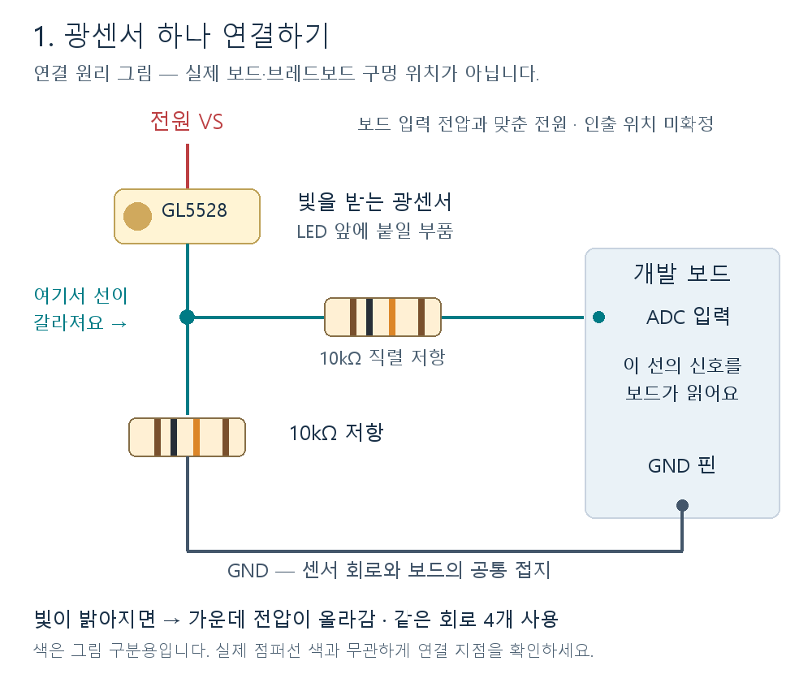
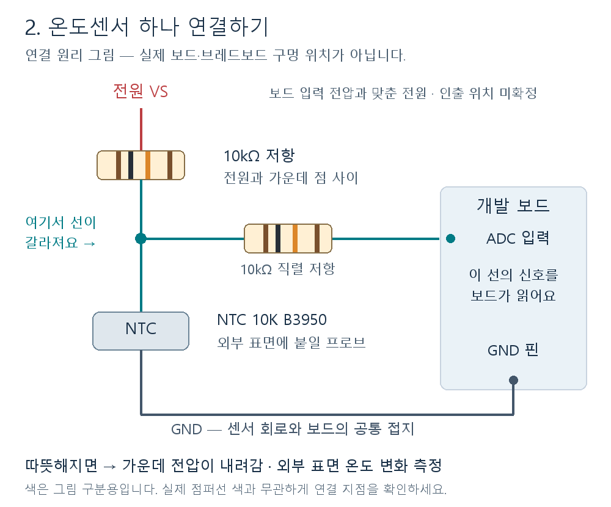
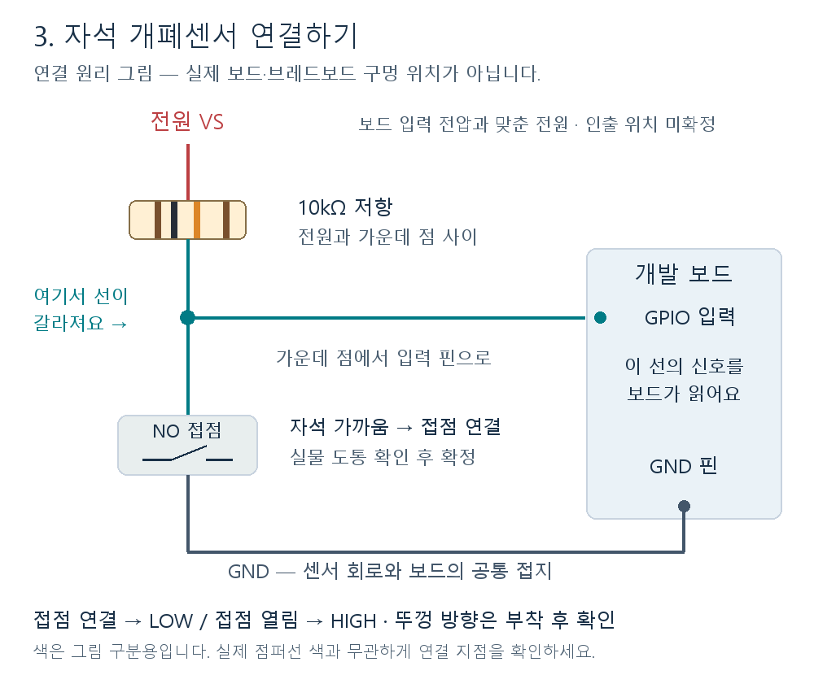

# A08 센서 배선 사전 설계

작성: 2026-10-05. 대상: CUCKOO CRP-G1020MP / nRF54LM20-DK PCA10184 rev 0.7.0.

**센서가 도착하면 어떤 회로로 연결할지 정한 초안이다. 실제 조립·전압 측정·센서 드라이버 검증은 아직 하지 않았다.** 센서 부품과 신호별 회로는 아래 방식으로 준비하고, 전원 인출 위치와 헤더 구멍 번호는 보드 실물·rev 0.7.0 회로도 대조 후 확정한다. 이 문서만 보고 임의의 전원 핀에 연결하지 않는다.

## 1. 만들려는 것

### 처음 읽는다면 여기부터

회로 기호를 외우기보다 **부품 두 개를 위아래로 연결하고, 그 사이에서 선 하나를 보드로 뽑는다**고 생각하면 된다. 광센서와 온도센서는 이 가운데 지점의 전압이 변하는 것을 읽는다.

- **VS:** 센서 회로에 공급하는 전원. 아두이노의 5V 핀처럼 생각해서 아무 곳에 꽂으면 안 된다. 이 보드의 사용 전압과 전원 위치는 확인 후 지정한다.
- **GND:** 회로의 공통 기준선. 센서 회로의 GND와 보드의 GND를 연결한다.
- **ADC 입력:** 전압의 높낮이를 숫자로 읽는 보드 핀. 광센서와 온도센서가 여기에 연결된다.
- **GPIO 입력:** HIGH/LOW 두 상태를 읽는 보드 핀. 자석 개폐센서에 사용한다.
- **10kΩ 저항:** 구매한 작은 막대형 저항. 저항 자체에는 앞뒤 극성이 없다.
- **그림의 점:** 선들이 전기적으로 연결되는 지점. 브레드보드의 연결된 구멍 등을 통해 실제로 이어야 한다.

먼저 아래 4절의 광센서 그림을 보고, 그 다음 온도와 개폐 그림을 보면 된다. 이미지는 문서와 함께 저장되어 인터넷 없이도 볼 수 있다. 부품 외형은 설명용이며 실제 비율·브레드보드 구멍 위치를 나타내지 않는다.

밥솥 외부에 센서를 붙이고 저전압 회로로 개발 보드에 연결한다. 밥솥 내부 PCB·전원·LED 배선과 전기적으로 연결하지 않는다. 잠금 LED는 빛으로 읽고, 실제 뚜껑 개폐는 자석 센서로 따로 읽는다.

```text
잠금 표시 ─ GL5528 + 저항 ─ ADC 광 0 ┐
보온 표시 ─ GL5528 + 저항 ─ ADC 광 1 │
백미 표시 ─ GL5528 + 저항 ─ ADC 광 2 ├─ nRF54LM20-DK
시간 첫 LED─ GL5528 + 저항 ─ ADC 광 3 │   → 기존 전처리·모델
외부 표면 ─ NTC + 저항 ─── ADC 온도 ┤   → 기존 Matter → HA/B
뚜껑/본체 ─ 자석 개폐센서 ─ GPIO ──┘
```

2026-10-06에 [A08 제품 앱 통합](../../firmware/a08/README.md)을 추가했다. ADC/GPIO 취득부터 전처리·모델·Matter 이력까지 연결하지만 기본 설정은 미보정 입력을 결측 처리한다. 아래 센서를 꽂는 것만으로 실제 측정으로 바뀌지 않는다. 전압·배선·보정을 실측한 뒤 취득 설정을 활성화해야 한다.

## 2. 구매 부품과 사용할 수량

구매 사실은 [확정 하드웨어 목록](README.md)을 기준으로 한다. 판매 상세 사양을 모두 재확인한 것은 아니다.

| 부품 | 보유 예정 | 이번 설계 사용 | 용도 |
|---|---:|---:|---|
| GL5528 CdS 광센서 | 5개 | 4개 | 나머지 1개 예비 |
| NTC 10K B3950, VLT-THS010 | 1개 | 1개 | 외부 표면 온도 변화 |
| 5C-39 NO 자석 개폐센서 | 1세트 | 1세트 | 뚜껑과 본체 상대 위치 |
| 10kΩ 1%, 1/8W | 20개 | 11개 | 분압 5개, 개폐 풀업 1개, ADC 직렬 5개 |
| MB-102 브레드보드 | 1개 | 1개 | 실험 회로 |
| M/F·M/M 점퍼선, 악어클립 점퍼 | 각 구매 묶음 | 배선 길이에 맞춤 | 보드·센서 연결 |

사용 가능 여부를 확인할 도구/소모품: 멀티미터, 절연 재료, 외부 부착용 고정재, 광센서 차광재, 케이블 고정재. 구매했다고 확인된 품목은 아니다. 새 센서나 ADC 모듈을 추가 구매하는 설계는 아니다.

## 3. 전원과 핀 배정 후보

Nordic 공식 전원 설명에서 DK의 기본 nRF 전원은 1.8V이고 설정에 따라 달라진다. GPIO 옆 P6/P7/P8/P9/P10/P18 전원 헤더에는 **5V 출력**이 있으므로 이를 센서 전원으로 착각하지 않는다. [전원 설명](https://docs.nordicsemi.com/r/bundle/ug_nrf54lm20_dk/page/ug/nrf54lm20_dk/hw_desription/power_supply.html), [GPIO·헤더 설명](https://docs.nordicsemi.com/r/bundle/ug_nrf54lm20_dk/page/ug/nrf54lm20_dk/hw_desription/connector_if.html).

이 문서의 `VS`는 **해당 GPIO 전원과 같은 전압으로 확인한 센서용 전원**이다. VDD:IO 인출을 우선 검토하되 정확한 인출 접점·허용 부하·기동 순서를 rev 0.7.0 회로도로 확인해야 한다. 현재 1.8V 또는 3.3V로 실측됐다고 주장하지 않는다. P14의 전원 점퍼를 빼거나 전류 측정 단자를 임의로 전원 출력처럼 사용하지 않는다.

| 신호 | 논리 이름 | SoC 핀 후보 | ADC 입력 | 보드 헤더 그룹 |
|---|---|---|---|---|
| 잠금 LED | optical[0] | P1.03 | AIN7 | P2 |
| 보온 LED | optical[1] | P1.04 | AIN6 | P2 |
| 백미 LED | optical[2] | P1.05 | AIN5 | P2 |
| 시간 첫 LED | optical[3] | P1.06 | AIN4 | P2 |
| NTC | temperature | P1.29 | AIN3 | P3 |
| 자석 개폐 | lid_contact | P1.10 | 디지털 입력 | P2 |
| 센서 전원 | VS | VDD:IO 계통 후보 | 해당 없음 | 인출 접점 미확정 |
| 공통 접지 | GND | DK GND | 해당 없음 | 실물 GND 표기 확인 |

**P1.03은 SoC 신호 이름이고 보드 커넥터 P1의 3번 구멍이라는 뜻이 아니다.** 위 표의 헤더 그룹과 실크의 신호 이름을 함께 찾는다. 커넥터 방향·구멍 번호는 아직 확정하지 않았다.

핀 후보는 SDK 3.4.1의 보드 DTS/pinctrl, 공식 GPIO 표, LM20B AIN 핀 명칭을 교차 확인했다. 현재 기본 버튼·LED·UART·NFC·외부 flash 핀을 피했다. 최종 앱의 생성된 `zephyr.dts`에서 이 핀들이 다른 기능에 할당되지 않았는지 다시 확인한다. P1.31은 문서 표기상 다른 기능과 혼동 여지가 있어 사용하지 않는다.

## 4. 광센서 회로 — 같은 회로 4개



그림을 위에서 아래로 읽으면 다음과 같다.

1. **광센서 한쪽 다리**를 전원 VS 쪽에 연결한다.
2. **다른 다리**를 아래쪽 10kΩ 저항의 한쪽 다리와 연결한다. 여기가 그림의 가운데 점이다.
3. 아래쪽 저항의 남은 다리는 GND에 연결한다.
4. 가운데 점에서 **별도 10kΩ 저항을 하나 더 거쳐** 보드 ADC 입력으로 연결한다.
5. 같은 회로를 LED별로 4개 만든다. 광센서 하나당 저항은 2개다.

가운데 점은 광센서·아래쪽 저항·오른쪽 저항이 만나는 **세 갈래 연결**이다. 오른쪽 ADC 선을 광센서의 전원 쪽에 붙이는 것이 아니다.

- 밝아질수록 CdS 저항이 작아지므로 이 배선에서는 측정 전압이 올라간다.
- `V광 = VS × 10k / (R광 + 10k)`. CdS가 10kΩ인 예에서는 VS/2이다.
- 직렬 저항은 ADC 쪽 전류 제한 후보다. 이상적인 고입력 임피던스에서는 분압비를 바꾸지 않지만, 실제 ADC 취득 시간·누설·오차를 확인해야 한다.
- 네 채널의 가운데 점은 각각 다른 행에 둔다. 서로 연결하지 않는다. VS와 GND만 공유한다.
- 센서는 LED 한 개의 빛을 보도록 고정하고 옆 LED·방 조명이 섞이지 않게 차광한다. 10kΩ으로 켜짐/꺼짐 분리가 부족하면 실측 후 저항 또는 부착 방법을 조정한다.
- 코드의 `led_off=500`, `led_on=3000`은 합성 예시다. 실물 임계값으로 복사하지 않는다.

## 5. NTC 회로 — 온도가 올라가면 전압이 내려감



광센서 그림과 비교하면 **위에는 저항, 아래에는 온도센서**가 온다.

1. 전원 VS에서 10kΩ 저항을 거쳐 가운데 점으로 연결한다.
2. 가운데 점에서 NTC의 한 선을 연결하고, NTC의 나머지 선은 GND에 연결한다.
3. 가운데 점에서 별도 10kΩ 저항을 거쳐 ADC 온도 입력으로 연결한다.

수동 2선 NTC 자체에는 전기적 극성이 없다. 두 선의 색보다 **저항이 위쪽, NTC가 GND 쪽**이라는 배치가 중요하다. 온도센서에도 저항은 총 2개를 사용한다.

현재 보정 설정의 `ntc_to_ground=true`와 같은 방향이다. 구매 기록의 10kΩ@25°C/B3950을 사용한 명목 계산은 다음과 같다. 실제 부품 허용 오차·온도 범위·프로브 절연 및 내열 등급은 수령 자료로 확인한다.

| 온도 | 명목 NTC 저항(근사) | V온도/VS |
|---|---:|---:|
| 25°C | 10.00kΩ | 0.500 |
| 60°C | 2.49kΩ | 0.199 |
| 80°C | 1.27kΩ | 0.113 |

계산: `Rntc = 10000 × exp(3950 × (1/Tkelvin − 1/298.15))`.
읽은 비율 `q=V온도/VS`에서 `Rntc=10000×q/(1−q)`로 복원한다.

외부 표면 측정값은 내솥·음식 온도가 아니다. 프로브를 증기구나 압력 장치에 넣지 않고 외부의 재현 가능한 위치에 부착한다. 뚜껑 패킹 사이로 선을 넣지 않는다. 정확한 위치는 실물에서 잠금·증기 배출·개폐 동작을 방해하지 않는지 확인해 사진과 함께 기록한다.

## 6. 자석 개폐 회로



이 센서는 **자석이 가까워지면 연결되는 작은 스위치**로 생각하면 된다. 실제 부품의 도통 동작은 먼저 확인한다.

1. 전원 VS에서 10kΩ 저항을 거쳐 가운데 점으로 연결한다.
2. 가운데 점에 센서의 한 선을 연결하고, 센서의 다른 선은 GND에 연결한다.
3. 가운데 점을 보드 GPIO 입력에 연결한다. 이 기본 회로는 저항 1개를 사용한다.

보통 전선이 나온 쪽이 접점 센서이고 반대편이 자석이다. 뚜껑과 본체에 하나씩 붙여 닫힐 때 서로 가까워지게 한다. 잠금 표시를 읽는 광센서와는 별개다.

전원 없는 상태에서 멀티미터로 자석 가까움/멀어짐의 도통 여부를 먼저 확인한다. 구매 기록대로 NO 접점이 자석 근접 시 닫히면 입력은 LOW가 된다. 자석을 뚜껑, 센서를 본체에 붙여 뚜껑 닫힘 때 근접하도록 배치할 경우 LOW→닫힘, HIGH→열림으로 보정할 수 있다. 실물 확인 전에는 이 극성을 확정하지 않는다.

외부 풀업을 쓸 때 GPIO는 입력으로 두고 불필요한 내부 풀다운을 켜지 않는다. 기존 50ms debounce는 시작 후보이며 실제 떨림을 보고 검증한다.

**단순 2선 NO 접점은 선이 끊어진 상태와 열린 접점을 구분하지 못한다.** GPIO를 읽었다는 이유만으로 케이블 정상까지 검증됐다고 기록하지 않는다. 단선 감지가 필요하면 종단저항+ADC 등 별도 회로/진단 설계가 필요하며 이번 기본 회로에는 포함하지 않았다.

## 7. ADC와 현재 소프트웨어를 맞추는 지점

현재 `tools/a07_edge/observations.py`의 NTC 계산은 `adc/adc_max = V입력/VS`를 가정한다. **12비트 ADC라는 이유만으로 실제 ADC raw/4095가 이 비율이 되지는 않는다.** 기준 전압과 gain에 따라 full-scale 전압이 달라진다. 실제 하드웨어 설정을 기록하고 아래 중 하나를 구현해야 한다.

1. 지원되는 기준/gain으로 분압 공급 전압과 일치하는 비율 측정 경로를 구성하고 검증한다.
2. ADC raw를 검증된 전압으로 바꾸고 `q=V입력/VS`로 정규화한 값을 기존 전처리에 전달한다. 원시 ADC 코드·기준/gain·공급 전압도 별도 로그에 보존한다.

둘 중 하나가 구현되기 전에는 실제 NTC 온도 계산이 연결 완료된 것이 아니다. nRF52 예제의 0.6V 기준을 LM20에 그대로 복사하지 않는다. 목표 칩의 SAADC 문서와 SDK 드라이버에서 설정 지원을 확인한다. [LM20 SAADC 디지털 출력 설명](https://docs.nordicsemi.com/r/bundle/ps_nrf54lm20a/page/saadc.html-saadc_digital_output)은 계산 원리 참고이며 최종 LM20B 설정은 해당 칩/SDK로 검증한다.

- 설계 목표: 광센서 채널당 20Hz, NTC는 기존 처리의 1Hz 온도 계산과 일치하도록 타임스탬프/갱신 시점을 명시한다.
- 분압의 출력 저항에 직렬 10kΩ까지 더해지므로 acquisition time을 충분히 확보한다. 긴 취득 시간에서 채널 전환 오차·반복값 안정성을 확인한 다음 줄인다.
- 처음에는 알려진 10kΩ 두 개의 1:1 분압으로 약 VS/2가 읽히는지 확인한다. 값이 기대와 다르면 센서를 보정하기 전에 ADC 스케일을 수정한다.
- ADC 시간 초과·포화·유효 범위 이탈은 품질 오류로 남긴다. 광센서의 완전한 어둠도 레일 근처일 수 있어 레일값만으로 물리 단선을 확정하지 않는다.
- 센서 한 채널 오류가 정상 채널까지 지우지 않게 하고, 기존 보류 조건에서는 AI를 unknown으로 둔다. raw 입력 adapter에 B 분석 로직을 추가하지 않는다.

LM20B Engineering B에는 전원 기동 중 일부 AIN 핀의 일시 단락 erratum이 있다. 칩 build code를 확인해 적용 여부를 기록한다. 이번 회로는 수동 분압과 채널별 직렬 저항을 사용하며 부팅 중 측정값을 정상 데이터로 쓰지 않는다. 저항만으로 erratum 검증을 마쳤다고 보지 않는다. [Nordic erratum 104](https://docs.nordicsemi.com/r/bundle/errata_nrf54lm20b_engb/page/err/nrf54lm20b/engineeringb/latest/anomaly_20b_104.html).

## 8. 센서 도착 후 조립 순서

1. **보드 USB를 빼고** 부품 모델·센서 다리·저항값·브레드보드 전원 레일의 중간 단절을 확인한다.
2. rev 0.7.0 회로도와 실물로 VS/GND 인출 위치와 핀 표를 확정한다. 전원만 켜서 VS 전압을 측정하고 다시 끈다. 분압 입력과 GPIO가 해당 전원 범위를 넘지 않도록 한다.
3. 개폐 센서 하나를 연결한다. 자석 근접/이탈→GPIO→lid_open 방향을 확인한다.
4. 광센서 하나를 연결한다. 손으로 가림/조명→ADC 변화와 VS/2 기준 시험을 확인한다.
5. 같은 광센서 회로를 네 개로 늘린다. 각 LED를 가리고 켜서 채널 순서를 확인한다.
6. NTC를 연결한다. 실온 기준과 손으로 가볍게 데웠을 때 저항/전압 변화 방향을 확인한다. 절대 온도 보정에는 별도 기준 온도계가 필요하다.
7. 외부 고정·차광 후 정상 사용 중 로그를 수집한다. 케이블이 뚜껑 이동이나 잠금을 방해하면 부착 위치를 수정한다.
8. 실제 입력 드라이버와 보정 버전을 적용해 같은 A05 전송 경계로 보낸다. `input_kind=test`에서 실제 출처로의 전환은 B의 검증된 live 생산자 계약을 따라 별도 확인한다.

브레드보드 행 번호는 최종 배치 전까지 지정하지 않는다. 연결마다 위 회로의 VS/중간 점/GND가 실제로 어디로 이어지는지 도통 확인한다.

## 9. 확정/미확정 기록표

| 항목 | 상태 | 다음에 남길 근거 |
|---|---|---|
| 구매 품목·센서 개수 | 저장소 구매 기록 확인 | 수령 부품 사진/표기 |
| 광 4채널·NTC·접점 회로 방향 | 사전 설계 완료 | 실측 값과 방향 |
| SoC 핀 후보·헤더 그룹 | 자료 대조 완료 | 최종 앱 dts·실물 핀 위치 |
| VS 인출 접점·구멍 번호·전압 | 미확정 | rev 0.7.0 회로도 대조·멀티미터 |
| ADC 기준/gain/취득 시간·정규화 | A08 코드 연결, 실측 미검증 | 1:1 분압 시험과 드라이버 설정 |
| GL5528 밝음/어두움 범위 | 미측정 | 채널별 원시 범위·주변광 |
| NTC 부착·온도 오차 | 미측정 | 부착 사진·기준 온도 비교 |
| 개폐 극성·부착 거리 | 미측정 | 열림/닫힘 조작 로그 |
| 실제 입력→보드→HA/B | 미검증 | 실행 ID·UART·HA 기록 |

관련 자료: [공식 rev 0.7.0 하드웨어 다운로드](https://www.nordicsemi.com/Products/Development-hardware/nRF54LM20-DK/Hardware-files), SDK `zephyr/boards/nordic/nrf54lm20dk/nrf54lm20dk_common.dtsi` 및 `nrf54lm20dk_nrf54lm20_a_b-pinctrl.dtsi`, [기존 보정 예제](../../tools/a07_edge/calibration.example.json), [A 개인 실행계획](../planning/A_개인_실행계획.md).
