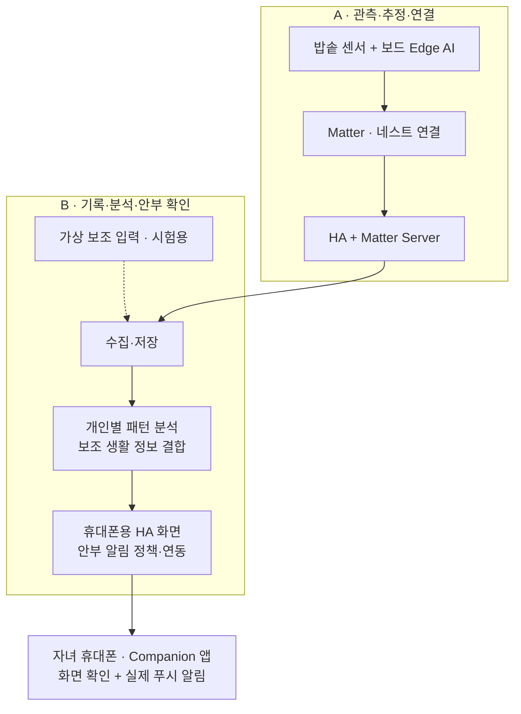

# 역할 분담

> 이 문서는 설계·정책 기준입니다. 실제 구현/설치와 미검증 범위는 [현재 검증 요약](../IMPLEMENTATION_STATUS.md)을 확인하세요.

작성일: 2026-10-02 · 장치·연결과 분석·서비스를 나누는 원격 협업안

기준: [시스템 아키텍처](../architecture/시스템_아키텍처.md)

**A는 밥솥 상태를 관측·추정하고 HA까지 연결한다. B는 그 기록과 가용한 다른 기기 정보를 분석하여 보호자의 안부 확인을 돕는 서비스를 만든다.** 아키텍처는 사용자가 정한 방향으로 진행하며, 상세 하드웨어·모델 종류는 미지정이다. 데이터 형식은 별도 계약 문서에서 관리한다.

## 1. 협업 조건

- **A: 현재 사용자.** 밥솥·네스트 허브·보드 등 실제 장비를 보유한다. 센서는 A 쪽으로 배송되며 10월 6일 발송 예정이다.
- **B: 팀원.** 멀리 떨어져 거주하며 직접 장비에 접근할 수 없다. 발표 당일에 만날 가능성이 있다.
- 실제 통합 환경은 A의 노트북과 로컬 네트워크다. B는 프로그램과 모델을 전달하고, A는 현장에서 실행·조작한다.
- 다른 Matter 기기를 보조 입력으로 사용할 수 있도록 설계한다. 이번에는 실제 보조 기기를 추가하지 않고 B가 가상 입력을 준비한다.

광센서는 열림/잠김·보온·백미와 상단 맨 왼쪽 ‘예약 2시간 / 찜 10분’ LED에 총 4개를 사용하는 계획이며, 구매한 5개 중 1개는 예비다. A는 추가 LED의 관측·제공을, B는 예약 관련 보조 정보와 개인 식사 시간대를 고려한 해석을 맡는다. 해당 표시등 하나가 정확한 예약 시간이나 예약 여부를 보장하는 입력은 아니다.

## 2. 기본 역할 분담

| 영역 | 주담당 | 책임 범위 |
|---|---|---|
| 센서·보드·펌웨어 | A | 밥솥 센서 관측, 신호 처리, 보드 실행 |
| 보드 Edge AI | A | 밥솥 상태 추정 모델의 학습·평가·배포·실행. B는 필요 시 평가 지원 |
| Matter 장치 구현 | A | 관측·추정 정보를 공통 활용할 수 있도록 제공 |
| 네스트·Google Home·HA·Matter Server | A | 설치·설정·등록·실제 수신·환경 관리 |
| Multi-Admin | A | 동일한 밥심 보드를 Google Home과 HA에 등록하고 상태 확인 |
| 가상 보조 정보 | B | 현관·움직임 등의 가상 입력과 부재/단절 시나리오 제공. 실제 추가 기기 연결은 범위 밖 |
| 수집·저장·기록 재생 | B | HA에서 정보를 수집·변환·저장하고 반복 개방을 우선 규칙으로 묶어 분석에 활용 |
| 개인별 패턴 분석 | B | 일반 초기 기준·선택 입력에서 약 일주일 초기 학습 후 지속 개인화. 기준선·특징 계산·모델 학습과 평가·패턴 변화 판단. 초기 참고 입력은 집에서 밥솥의 밥을 꺼내 먹는 시간과 요일별 생활 습관 등을 선택적으로 받음 |
| 보조 생활 정보 결합 | B | 다른 기기 정보가 있을 때 분석에 반영하고, 없을 때는 밥솥 기반 동작 유지 |
| 휴대폰 화면·보호자 알림 | B | 기존 HA 대시보드를 Companion 앱에서 볼 수 있게 구성하고 분석 결과·알림 내용·우선순위·중복 방지 연결. 확인 응답·기간 지정 알림 보류 포함 |
| 휴대폰 외부 접속 환경 | A 주도 | HA·앱 연결과 외부 접근 환경 준비. B는 화면·알림 동작을 함께 확인 |
| 현장 실행·피드백 | A | 전달받은 서비스 실행, 장비 조작, 로그·동작 기록 공유 |
| 서비스 오류 분석·수정 | B | 수집·분석·화면·알림 코드와 모델의 문제 해결 |

A가 현장 실행을 맡는다고 B의 서비스 개발·수정 책임까지 A에게 넘어가지는 않는다. HA 실행 환경 자체는 A가, B가 작성하는 화면·알림 설정과 서비스 로직은 B가 관리한다.

### 기존 HA 기능을 활용해 줄이는 개발 범위

별도 보호자 앱을 새로 만드는 대신 기존 Companion 앱과 HA의 화면·알림 전달 기능을 사용한다. **B의 역할은 학습 모델만 만드는 것으로 끝나지 않는다.** 수집·저장·사용 행동 정리·개인 기준 갱신·추론 실행·알림 정책·화면 및 알림 연동은 밥심 서비스 작업이다. A는 HA 환경과 실제 장치·휴대폰 연결을 담당한다.

대상은 밥솥에서 밥을 꺼내 먹는 사람으로 제한하고, 소분·냉동 주 사용자 해석과 실제 식사 횟수·남은 밥의 양 계산은 제외한다. 반복 개방 경계 학습과 모든 예외 상황의 별도 분류도 이번 핵심 범위에서 제외한다. 개방은 첫 개방부터 60분 고정 창으로 묶는다. 규칙적인 사용의 첫 안내는 두 예상 창의 연속 미관측, 불규칙한 사용은 개인별 간격을 기준으로 한다.

## 3. 두 AI와 다른 기기 연계의 경계

| 기능 | 담당 질문 | 책임 |
|---|---|---|
| 보드 Edge AI | 지금 밥솥은 어떤 상태로 보이는가? | A가 주도. 관측값과 추정 결과를 함께 제공 |
| 노트북 패턴 분석 | 평소와 비교해 밥솥 사용이 달라졌는가? | B가 주도. 이력과 개인 기준선을 활용 |
| 보조 정보 결합 | 다른 생활 활동 정보가 해석에 어떤 맥락을 더하는가? | B는 가상 보조 입력과 결합 판단, A는 통합 실행 지원 |

보드 AI는 밥솥 자체의 상태 추정에 집중한다. 다른 기기와의 결합은 노트북 분석에서 수행한다. Multi-Admin은 같은 기기를 복수 플랫폼에서 사용하는 기능이고, 보조 정보 결합은 여러 기기를 하나의 서비스에서 활용하는 기능이다.

보조 기기가 없거나 끊겨도 밥솥만으로 기본 분석을 유지한다. 미설치·단절·오래된 값을 활동 없음으로 해석하지 않는다. 다른 활동이 있다는 이유만으로 안부 확인을 무조건 취소하지 않는다. 세부 판단 기준과 전달 형식은 후속 설계 대상이다.

B는 밥솥 단독과 가상 보조 정보 결합의 비교 시나리오를 준비한다. 이번 실제 보조 기기 추가·연결은 범위 밖이다. 실제 기기 입력과 가상 입력을 구분하며, 오탐 감소는 비교를 통해 확인할 목표로 둔다.

## 4. 기능별 협업 흐름

그림은 기능과 책임의 구분이다. 실제 실행은 A 쪽 통합 환경에서 이루어지며, B의 집으로 실시간 Matter 통신을 보내는 구조가 아니다. 물리 경로와 Google Home 등록 관계는 아키텍처 문서를 따른다.

## 5. 인터페이스와 기록의 인계

| 항목 | A | B |
|---|---|---|
| 밥솥 정보 | 제공 가능한 관측·추정과 의미 설명 | 분석에 필요한 정보와 사용 목적 설명 |
| 보조 정보 | 가상 시험의 실행 지원 | 가상 입력 의미·품질·시나리오와 결합 로직 설계 |
| HA 접근 | 수신 환경과 접근 설정 제공 | 수집·변환 코드 작성 |
| 데이터 계약 | 장치 의미와 제공 가능 범위 검토 | 서비스 관점의 설계서 작성, A와 함께 확정 |
| 실측 기록 | 실제 동작 메모와 기록 공유 | 재생·모델 평가·오류 재현에 활용 |

[보드 출력 설계서](보드_출력과_상태_추정.md)과 [A–B 데이터 계약 설계서](../contracts/AB_데이터_계약.md)에서 관측·추정의 의미와 B 수집기의 필드·단위를 제안했다. A는 실제 제공 경로·지원 여부를 인계하고, B는 수집·변환 코드를 작성한다. 실제 주기·클러스터·모델 파일 형식은 아직 미정이다. 별도 확장 수신이 필요하면 HA까지 정보를 노출하는 부분은 A가 주도하고, 이후 해석·저장은 B가 맡는다.

## 6. 원격 전달과 실행

B는 학습된 패턴 분석 모델과 실행 코드를 **Docker 이미지로 전달**한다. 이는 서비스 배포 방식이며 프로젝트의 기능 구분이나 HA 설치 방식을 결정하는 기준은 아니다. A가 자기 노트북에서 실행할 수 있도록 버전·설정 예시·실행 방법·로그 확인·이전 버전 복원 안내를 함께 제공한다. 필요한 HA 화면·알림 설정은 별도 파일로 전달할 수 있다.

협업은 **B 개발·자체 확인 → A에게 전달 → A 현장 실행 → 기록·로그 공유 → B 진단·수정** 흐름으로 진행한다. 실행할 때마다 모델을 다시 학습할 필요가 없도록 학습된 모델과 입력 처리·추론 코드를 함께 제공한다. 학습·평가 자료도 B가 관리한다. 배포 후 개인별 기록을 바탕으로 기준을 갱신하는 학습·보정 코드도 B가 제공하고, A 쪽 실행 환경에서 동작하게 한다. B가 고정된 학습 결과 하나만 전달하는 방식으로 개인화를 끝내지 않는다.

A는 실행 기반 환경과 현장 조작을, B는 자기 프로그램의 실행 요건·수정·기록 보존 안내를 책임진다. 반복 시험은 확인할 동작을 묶어 요청하고, B가 공유된 기록으로 재현할 수 있는 문제는 자기 환경에서 먼저 확인한다.

## 7. 문제 해결 책임

| 문제 | 주담당 | 상대방 지원 |
|---|---|---|
| 센서·펌웨어·보드 AI | A | B가 필요 시 기록 분석 지원 |
| 네스트·HA·Matter 등록·Multi-Admin | A | B가 서비스에서 관측한 결과 제공 |
| 가상 보조 입력·시나리오 | B | A가 통합 환경에서 실행 지원 |
| HA에는 있지만 서비스가 정보를 못 읽음 | B 주도 | A가 접근 설정·HA 상태 확인 |
| 패턴 분석·보조 정보 해석·알림 오류 | B | A가 실제 동작과 관측 상황 공유 |
| 서비스 배포본 자체의 기동·의존성 오류 | B | A가 실행 환경과 로그 공유 |
| 정보 의미 불일치 | 공동 | 장치의 실제 의미와 서비스 해석을 비교 |

## 8. 문서와 시연

- **A:** 장치·보드 추론·Matter·HA 환경, Multi-Admin, 실제 장치 연결 설명.
- **B:** 개인별 분석·보조 정보 결합·알림 흐름, 모델 평가, 서비스 실행 안내.
- **공동:** 실제 사용 시나리오, 정보 의미, 정상 동작 버전 조합.

발표 전 A 쪽에서 전체 흐름을 연결해 보고 같은 노트북과 확인된 설정을 시연 기준으로 유지한다. 발표 장소의 연결 환경과 재시작은 A가, 서비스 실행·로그·복원 안내는 B가 준비한다. 보조 정보는 가상 시나리오로만 검증·시연하고 실제 타사 기기 연동과 구분한다.

발표의 완료 기준에는 실제 자녀 역할의 휴대폰에서 알림을 받고, 부모님 집 밖의 네트워크에서 밥심 상세 화면을 여는 흐름을 포함한다. 노트북에 알림 화면만 띄우는 것으로 대체하지 않는다.

## 9. 이번 반영 내용

HA·Matter 환경과 보드 Edge AI는 A, 기록·패턴 분석·알림은 B라는 분담을 유지한다. 다른 Matter 기기의 선택적 보조 입력을 추가하여 A는 연결을, B는 해석을 맡는다. 후속 팀 합의에 따라 반복 개방 규칙 처리·약 일주일 초기 학습 후 개인화·소분 주 사용자 제외·기존 Companion 앱 활용을 반영했다. 기존 앱 활용으로 앱 자체 개발은 줄이되 B의 수집·분석·알림 연동 책임은 유지한다. 배포 방식은 6절에만 명시했다.

이 문서는 현재 역할 분담의 기준이다. 실제 보조 기기는 추가하지 않으며 데이터 형식은 상세 계약을 따른다.

## 팀 검토용 상세 설계 추가

[전체 합의안](팀_상세설계_합의안.md)에 Matter·HA 연결, 분석·알림 정책, 출력 계약, 설치·복구·통합시험 추천안을 추가했다. 기존 아키텍처와 역할을 유지하며, 최종 팀 동의로 갱신한 결정은 해당 합의표를 따른다. 기술 검증·조정 가능한 후보 수치는 별도로 표시한다.

## 최종 합의에 따른 작업 범위

A는 사용자 진술상 Galaxy Book3 Pro / Windows 10 Pro의 HA OS VM·Matter Server 구성, HA Cloud 체험 설정과 외부 접속·실제 폰 시험을 담당한다. B는 확인/기간 보류의 상태 관리·HA 조작 연동·개인 학습에서 여행 구분을 추가 구현한다. 실제 보조 기기 연결 업무는 이번 범위에서 제외하고 가상 입력을 B가 제공한다. 기록 보존은 관측90일·행동/기준/판단/발송180일로 하며, A의 환경 관리와 B의 저장 코드 책임을 유지한다. 소스 코드까지 공개하는 방향을 채택했으며 실제 게시와 라이선스 정리는 후속 작업이다.
