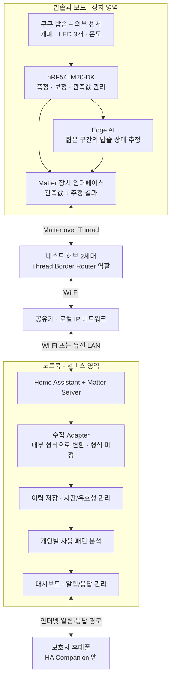
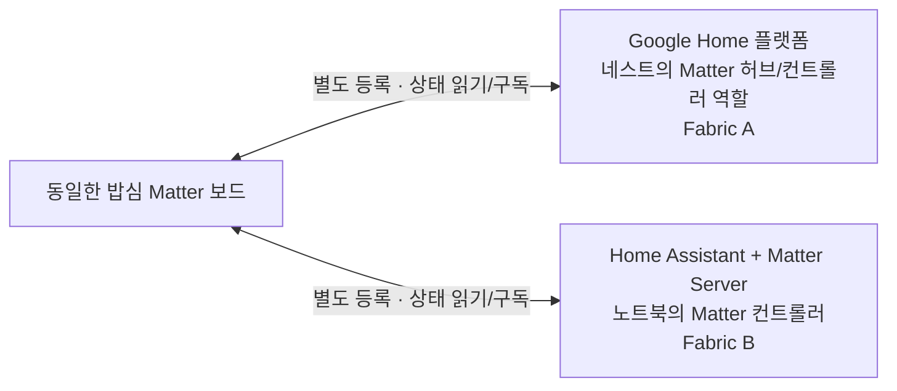
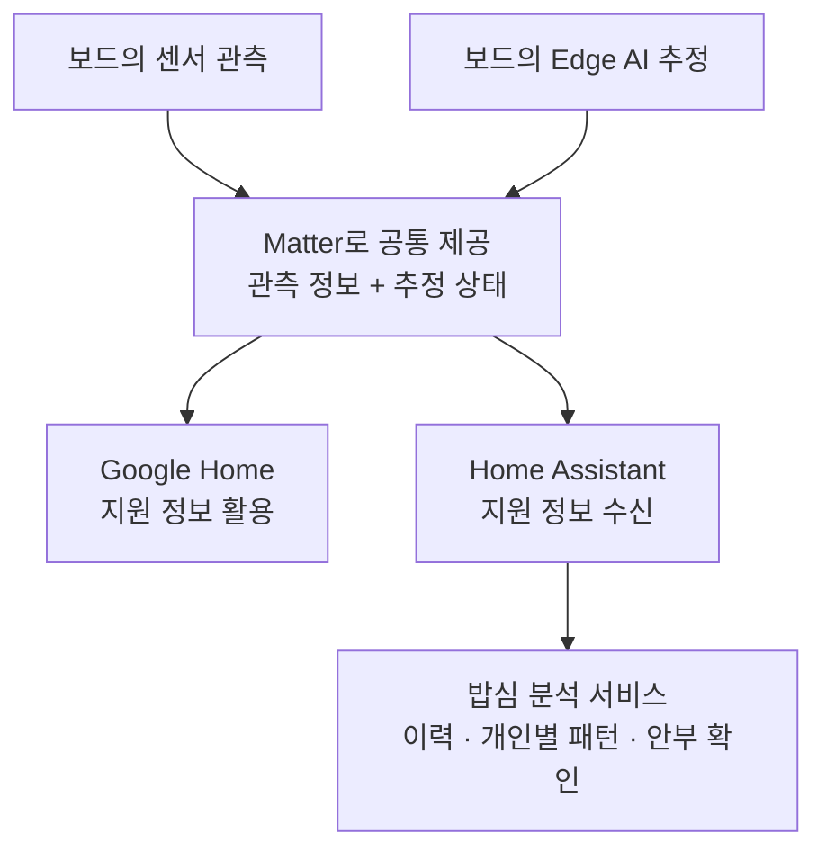
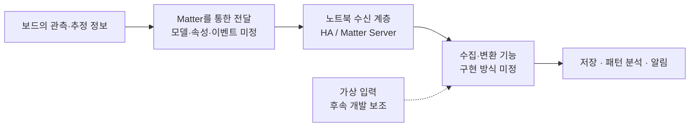

# 밥심 시스템 아키텍처 v0.2

작성일: 2026-10-02 · 용도: 사용자 결정에 따른 시스템 아키텍처 공유

> 이 아키텍처는 사용자가 정한 방향으로 진행한다. 팀의 별도 아키텍처 합의를 기다리는 문서가 아니라, 구현할 구조를 공유하는 기준 문서다. 역할 분담은 별도 문서에서 다루며, 하드웨어 상세와 데이터 형식은 미지정이다. 구조의 결정과 실제 구현 완료는 구분한다.

## 1. 아키텍처 기준과 범위

밥심은 일반 밥솥의 사용 관련 행동을 관측하고, 평소 패턴과 다른 변화가 있으면 보호자의 안부 확인을 돕는다. 뚜껑 개방을 식사 완료로, 사용 감소를 건강 이상으로 단정하지 않는다.

| 항목 | 현재 기준 |
|---|---|
| 확보·구매 장비 | 쿠쿠 CRP-G1020MP, nRF54LM20-DK, 구글 네스트 허브 2세대 |
| 센서 | 자석 개폐센서, NTC 온도센서, 광센서 5개 구매. 광센서 3개 사용 계획, 2개 예비 |
| 배송 | 센서 2026-10-06 발송 예정. 수령일 미확정 |
| 물리적 연결 | 보드 ↔ Thread ↔ 네스트 ↔ Wi-Fi ↔ 공유기 ↔ Wi-Fi 또는 LAN ↔ 노트북 |
| Edge AI | 고득점을 위한 핵심 설계 목표로 포함. 모델·분류 상태·SDK·NPU 사용 여부는 미정 |
| Multi-Admin | 같은 보드를 Google Home과 HA에 각각 등록하는 것을 핵심 설계 목표로 포함 |
| 정보 제공과 서비스 | 보드의 관측·추정 정보를 Matter로 공통 제공하고, 밥심은 그 이력으로 패턴 분석 서비스를 구성. 구체적인 형식은 전부 미지정 |
| 서비스 | 노트북에서 수집·저장·개인별 패턴 분석, HA Companion 앱으로 보호자 알림·응답 |

v0.1에서 선택 기능으로 두었던 Edge AI와 Multi-Admin을 이번 버전에서는 목표 범위에 넣는다. 구체적인 모델과 전송 매핑이 확정되었다는 뜻은 아니다. 기존 인계 문서의 ‘네트워크 장비 미확정’ 기록은 네스트 구매 사실로 갱신하여 해석한다.

## 2. 실제 장비와 통신 경로

**노트북이 Thread를 직접 수신하지 못하므로 네스트의 Thread Border Router를 거쳐 보드와 통신한다. Multi-Admin을 추가해도 이 경로는 유지된다.**

이 그림은 HA까지의 물리적 통신 경로와 서비스 흐름이다. 보드와 HA가 무선으로 직접 연결되는 구조가 아니다. 네스트는 HA로 향하는 Matter 통신을 전달하며, 분석용 내부 정보로의 변환은 노트북의 수집 프로그램이 담당한다.

## 3. Multi-Admin: 같은 보드를 두 플랫폼에 등록

다음 그림은 **기기 등록과 접근 관계**다. 화살표가 물리적 직결을 뜻하지 않으며, HA 통신은 위 그림의 네스트·공유기 경로를 이용한다.

| 네스트 한 대의 역할 | 의미 |
|---|---|
| Thread Border Router | Thread 보드와 집 안 IP 네트워크를 연결. 원래 설계부터 필요한 역할 |
| Google Home의 Matter 허브 | Google Home에 등록한 보드의 상태를 이용. Multi-Admin 목표에서 함께 활용하는 역할 |

등록 관계를 이해하기 위한 예시이며, 실제 절차와 담당은 후속 설계에서 정한다:

1. 보드를 Google Home에 Matter 기기로 등록한다.
2. 기기 공유 절차로 같은 보드를 HA에도 등록한다. HA에서 시작하여 Google Home에 공유하는 순서도 가능하다.
3. Google Home과 HA가 각각 보드의 상태를 읽고 변경 보고를 받는다.

등록 대상은 **센서값이 아니라 기기**다. 네스트에 값이 도착하면 자동으로 두 플랫폼에 등록되거나 복제되는 것이 아니다. 두 플랫폼은 각각 등록 관계와 접근 권한을 가진다. HA 화면을 Google에 단순 연동하는 방식도 이 Multi-Admin 목표와 구분한다.

Google Home 앱·네스트 화면에 어떤 정보가 표시되는지는 플랫폼 지원 범위에 따라 달라진다. 이 구조는 두 플랫폼에 동일한 화면이 제공된다는 뜻은 아니다.

## 4. Edge AI와 노트북 분석의 분업

**보드는 ‘지금 밥솥의 상태’를 추정하고, 노트북은 ‘평소 대비 사용 패턴의 변화’를 판단한다.**

| 구분 | 보드 Edge AI | 노트북 밥심 분석 |
|---|---|---|
| 입력 | 최근 온도·LED·개폐의 시간 흐름 | 관측 이력, 보드 추정 이력, 개인별 기준선 |
| 시간 범위 | 수초~수분 후보. 길이 미정 | 수시간~수일 이상. 기준선 기간 미정 |
| 출력 | 밥솥 상태 추정 또는 판단 불가 | 사용 감소·지연, 안부 확인 필요 여부 |
| 예시 | 메뉴 선택과 실제 가열 상태 구분 | 평소 대비 개방 횟수 감소 판단 |
| 책임 영역 초안 | 보드에서 센서 정보를 해석하는 기능 | 기록을 이용해 사용 패턴을 해석하는 기능 |

취사·보온 등의 분류 목록은 후보이며 센서로 구분 가능한지 검증할 대상이다. 모델 학습은 노트북 등에서, 추론은 보드에서 실행할 수 있다. 모델 종류·메모리·SDK·NPU 사용 여부는 미정이다.

AI 결과와 원래 관측값을 함께 유지한다. AI가 판단하지 못할 때도 기본 관측 흐름은 유지되어야 한다. 보드의 상태 추정 결과는 노트북의 사용 이력 해석에 활용하며, 보호자 알림에 필요한 장기 패턴 판단은 노트북에 둔다.

## 5. Matter로 제공할 관측·추정 정보와 밥심 분석 서비스

**센서 관측값과 보드의 추정 상태를 모두 다른 플랫폼에서도 활용할 수 있도록 Matter로 제공하는 것이 설계 목표다.** 밥심의 차별성은 이 정보를 축적하여 개인별 패턴을 분석하고 보호자의 안부 확인으로 연결하는 서비스에 둔다.

| 계층 | 정보 또는 기능 | 아키텍처에서의 위치 |
|---|---|---|
| 관측 정보 | 뚜껑 개폐, 설치 지점 온도, LED 점등 등 | 보드에서 생성하여 Matter로 제공 |
| 추정 정보 | Edge AI가 판단한 밥솥 상태 등 | 보드에서 생성하여 관측 정보와 함께 Matter로 제공 |
| 플랫폼 활용 | 기기 등록, 상태 읽기·구독, 지원되는 표시·자동화 | Google Home과 HA가 각각 같은 기기에 접근 |
| 밥심 분석 서비스 | 이력 축적, 개인 기준선, 사용 패턴 변화 판단, 보호자 알림 | 노트북에서 실행하며 HA와 연결 |

이 그림은 정보의 활용 관계이며 실제 통신은 2절의 네스트 경로를 따른다. 다른 플랫폼이나 개발자도 제공된 정보를 활용해 별도의 분석 서비스를 만들 수 있다. 밥심만 정보를 해석할 수 있도록 제한하는 구조가 아니다.

표현 방식은 기존 Matter 표준을 우선한다. 기존 표준으로 의미를 정확히 표현하기 어려운 정보는 확장 모델을 검토하고, 다른 구현에서도 재사용할 수 있도록 정의를 문서화하는 방향이다. 최종 전달 항목과 데이터 형식은 모두 미지정이다.

**공통으로 제공하려는 목표와 플랫폼이 기본적으로 이해·표시하는 범위는 구분한다.** 확장 모델이 필요하다면 HA 측 읽기·구독과 수집 코드도 함께 설계해야 한다. Google Home이 새로운 상태를 자동으로 이해한다고 가정하지 않는다. 이것은 플랫폼 지원의 차이이며, 일부 정보를 밥심에만 제공한다는 뜻이 아니다.

밥솥의 관측·추정 정보를 재사용 가능한 Matter 데이터 모델로 구성하는 것도 프로젝트의 기여 방향이다. 자체 확장 모델의 설계·공개와 공식 Matter 표준 채택은 구분한다. 특정 버전에 전용 밥솥 모델이 없다고 미리 단정하거나 자체 모델을 공식 표준으로 부르지 않는다.

## 6. 데이터가 이동하는 책임 경계 — 형식은 전부 미지정

이 그림은 처리 단계만 보여준다. 실제 통신은 네스트와 공유기를 거친다. Simulator의 연결 위치 역시 입력 계약을 정할 때 구체화한다.

이 계층 구분의 목적은 보드의 관측·추정 기능과 노트북의 수집·장기 분석 기능을 연결하는 것이다. 구체적인 데이터 항목, Matter 매핑, 내부 형식은 모두 미지정이다.

## 7. 로컬 동작과 장애 경계

아래는 구성요소가 멈췄을 때의 서비스 범위를 논의하기 위한 내용이다. 저장·재시도·복구 방식은 아직 정하지 않는다.

| 상황 | 설계 목표 또는 경계 |
|---|---|
| 외부 인터넷 단절, 로컬 네트워크 정상 | 보드 추론·HA 수집·노트북 분석 유지 목표. 외부 알림은 보류/재시도 정책 필요 |
| 노트북/HA 중단 | 보드 추론과 Google Home 연결을 분리해 유지하는 것이 목표. 노트북의 장기 분석·알림은 중단 |
| 네스트 전원 차단 | 유일한 Thread Border Router 경로가 끊김. 보드의 로컬 측정·추론 지속 여부와 이력 보존 정책 정의 |
| 특정 센서 오류 | 해당 관측/추정의 유효성 표시. 다른 정상 관측까지 오류로 덮어쓰지 않음 |

Multi-Admin은 서로 다른 플랫폼에 기기를 등록하는 기능이며, 네스트를 두 대로 만드는 네트워크 이중화가 아니다. ‘로컬 동작’은 Google 계정 설정·기기 등록·외부 알림을 포함한 모든 기능이 인터넷 없이 동작한다는 약속도 아니다.

## 8. 심사 기준에 대응하는 아키텍처

사용자가 제공한 본선 심사표를 기준으로 한다. 배점은 획득 점수의 예측이 아니다.

| 평가 항목 | 배점 | 아키텍처에서 대응하는 부분 |
|---|---:|---|
| Matter 구현 완성도 | 30 | 보드를 실제 Matter 장치로 구성하고 표준 의미에 맞게 정보를 전달 |
| 상호운용성 | 20 | Google Home과 HA가 동일 보드에 각각 등록되는 Multi-Admin |
| 온디바이스 AI/AX 활용성 | 20 | 보드의 상태 추정과 노트북의 로컬 패턴 분석 |
| 창의성 및 문제해결성 | 15 | 일반 밥솥의 사용 관측을 보호자의 안부 확인으로 연결 |
| 사업화 및 기여도 | 15 | 재사용 가능한 관측·추정 모델, 다른 기기로의 확장, 코드·문서 공개 방향 |

현재 아키텍처는 설계 범위상 다섯 심사 항목 모두에 대응한다. 이번 구조는 온디바이스 활용을 직접 보여주기 위해 보드 추론을 목표로 포함한다. 다른 가전이나 추가 플랫폼은 현재 기본 아키텍처에 포함하지 않는다.

## 9. 참고와 버전 이력

- [v0.1](밥심_시스템_아키텍처_v0.1.md): 최초 구조와 인터페이스 후보.
- v0.2: 물리 경로와 등록 관계 분리, 네스트의 두 역할, Edge AI·Multi-Admin 목표 및 장애 경계 반영. 표현을 ‘Matter로 제공할 관측·추정 정보 / 밥심 분석 서비스’로 정리. 상세 하드웨어·데이터 형식은 지정하지 않음.
- [역할 분담 제안 v0.2](../planning/밥심_역할_분담_제안_v0.2.md): A의 장치·Edge AI·HA 환경 담당과 B의 패턴 분석·Docker 서비스 전달을 정리한 별도 문서.
- [기존 인계 문서](../context/밥심_최신_프로젝트_인계_컨텍스트_2026-10-02.md): 배경 자료. 충돌 시 이 문서에 반영한 최신 사용자 결정 우선.
- [HA Matter: 복수 플랫폼 등록과 공유](https://www.home-assistant.io/integrations/matter/)
- [Google Home: 지원 기기와 허브](https://developers.home.google.com/matter/supported-devices)
- [Google Home: 개발용 기기 등록 설정](https://developers.home.google.com/matter/get-started)
- [Google Nest Hub 2세대 사양](https://store.google.com/product/nest_hub_2nd_gen_specs?hl=en-US)
- [Nordic Edge AI 문서](https://nrfconnectdocs.nordicsemi.com/addons/addon-edge-ai/latest/quick_start/edge_impulse.html)

외부 문서는 설계 참고자료다. 보유 보드 리비전·SDK·확장 데이터 수신·화면 표시가 구현 검증되었다는 의미는 아니다.
