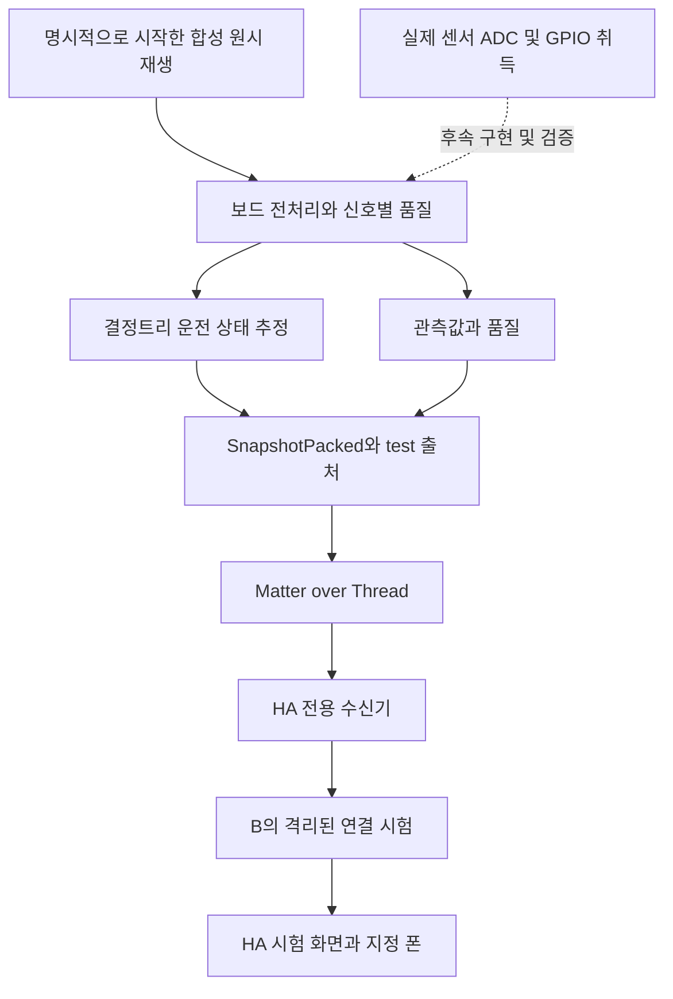

# A 장치 연결 구현과 검증 종합 점검 보고서

2026년 10월 5일 · 검토자 Codex · 수신자 A 및 프로젝트 담당자

## 1 결론과 판단 범위

**A 담당 장치 경로에는 보드 전처리와 추론부터 Matter·HA 수신 및 시험 폰 연결까지 작동하는 기반이 있다. 그러나 합성 입력의 보드 대조와 연결 시험 성공만으로 실제 센서 기반 운영이 완성됐다고 승인하기는 어렵다.** 출처·신호 품질·버전 관리와 실기 대조에는 구체적인 구현과 증거가 있다. 반면 짧은 개폐의 보존, 관측 공백 이후 LED 상태 처리, 느린 점멸 구분에는 보완이 필요하다.

이 보고서는 사람의 역량이나 성실성을 평가하지 않는다. 현재 main에 합쳐진 **A 책임 범위의 결과물**과 작업 중인 A08 사전 설계를 합의사항과 대조한다. 공동 통합 코드도 포함하므로 모든 줄의 작성자를 A라고 단정하지 않는다. B의 분석·알림 결함은 A의 구현 결함으로 중복 평가하지 않았다. 제품 코드는 수정하지 않았다.

| 점검 축 | 판단 | 핵심 근거 |
|---|---|---|
| 요구사항 대조 | 시험 연결 기반 구현, 실제 입력과 일부 전달 요구 미완료 | A01~A07 기록과 현재 소스 대조. A08 실측 취득은 후속 범위 |
| 대표 장치 시나리오 | 주요 기본 동작 통과 및 경계 조건 보완 필요 | 관련 자동시험 42개, 기존 실기 기록, 추가 입력 반례 |
| 모델 평가 | 합성 자료 안에서 재현 가능하나 실제 정확도 미확정 | 저장된 일반·스트레스 평가 재계산 및 동일 입력의 규칙 비교 |
| 운영 신뢰성 | 짧은 재부팅·복구 기반 확인, 개폐 보존과 장시간 검증 부족 | 기존 빠른 조작 누락 기록, 관측 공백 처리 반례 |
| 실제 사용자 흐름 | 개발용 폰 연결 기록 확인, 운영 종단 흐름 미완료 | 기존 같은 Wi-Fi 수신·클릭 기록. 외부 상세 접근과 응답은 별도 |

권고는 **센서 도착 전 개발 기반을 유지하되, 실제 센서 기반 운영 완료 승인은 보류**하는 것이다. 10절의 선행 보완과 11절의 현장 시험을 완료한 다음 다시 판단한다. 센서가 없어 수행할 수 없는 실측 시험과 이미 확인된 구현 결함을 구분했다.

## 2 기준 버전과 증거 수준

검토 기준 커밋은 `7f3e206def3f98bfdb3a8c25dc3d4f2ca64cfc90`이다. 검토 시작 때 `docs/hardware/README.md`, `docs/planning/A_개인_실행계획.md`가 수정 중이었고 A08 문서와 이미지 폴더가 미추적 상태였다. 해당 작업물과 `firmware/`는 수정·이동·스테이징하지 않았다. 검토 결과와 증거만 추가했다.

A의 범위는 [역할 분담](../planning/역할_분담.md)과 [A 실행계획](../planning/A_개인_실행계획.md)의 센서·관측 처리·보드 상태 추정·Matter·HA 환경·현장 실행이다. 오래된 아키텍처 자료의 사용자 역할 표기보다 현재 명시된 A/B 분담을 적용했다. B의 분석·알림 결함은 A의 구현 결함으로 중복 평가하지 않았다.

이번 검토는 소스 읽기, 관련 자동시험, 기존 합성 평가 재계산, 추가 경계 입력 시험, 보관된 보드 로그·화면·해시 대조를 수행했다. 보드를 재플래시하거나 HA 설정을 변경하거나 실제 폰 알림을 보내지 않았다. 기존 실기 기록은 과거 실행 증거이며 이번에 장비를 다시 조작한 결과가 아니다. 현재 설치 이미지 전체를 장치에서 읽어 검증하지도 않았다.

작업 중인 A08 문서와 그림을 포함해 검토했지만 내용을 수정하지 않았다. `firmware/`와 운영 소스는 변경하지 않았다. A08 전원·핀 설계는 미확정 항목과 코드 연결 조건을 검토한 것이며 실물 전기적 적합성이나 조립 안전성의 승인 시험은 아니다.

주요 근거 파일:

- [이번 추가 시험 스크립트](a-review-20261005/audit.py), [결과 JSON](a-review-20261005/results.json), [최종 자동시험 로그](a-review-20261005/tests-final.log)
- [A05 구현과 빠른 버튼 실기 기록](../hardware/A05_데이터모델_구현.md)
- [A07 합성 학습과 보드 대조](../hardware/A07_합성학습_검증.md), [A07 실제 연결 기록](../hardware/A07_AB_연결_실기검증.md)
- [A06 배포와 복구 기록](../hardware/A06_HA_OS_배포_검증.md), [A08 작업 중 사전 설계](../hardware/A08_센서_배선_사전설계.md)

이 보고서의 상태 용어는 다음과 같다.

- **실행 확인:** 이번 검토에서 현재 Python 소스를 실행해 관찰한 결과. 실제 ADC나 보드 실행을 대신하지 않는다.
- **코드 확인:** 실제 함수와 호출 경로를 읽고 확인한 구현. 실물 동작까지 보증하지 않는다.
- **보관 화면 확인:** 기존 실기에서 저장한 HA 화면을 이번에 읽고 확인한 결과. 현재 설치 화면의 새 관찰은 아니다.
- **기존 실기 기록:** 앞선 A01~A07 현장 검증 문서·로그의 기록. 이번에 재실행한 실적으로 세지 않는다.
- **미검증:** 필요한 실제 입력·장비 조작·운영 기간의 증거를 확보하지 못한 항목.

## 3 A가 만든 구조



현재 A07 시험 앱은 버튼으로 시작한 네 상태를 15초 간격으로 발행하고 종료한다. 실제 센서를 계속 읽는 앱은 아니다. 전처리·추론이 보드에서 실제 실행되므로 고정 문구만 보낸 시험도 아니다. 다만 `select_stages()`가 모델이 각 상태를 내는 입력을 골라 연결하는 방식이므로 네 단계 성공은 **전송·통합 검증**이지 분류 정확도 시험이 아니다.

표준 개폐·온도 속성과 별도로 확장 Snapshot을 제공한다. B까지의 확장 수신은 `tools/a05_contract/ha_sensor.py`의 5초 최신값 읽기를 사용한다. Snapshot 한 개 안의 값 일관성은 확보하지만, 폴링 사이에 지나간 모든 행동을 보존하지는 못한다.

| 계층 | 주요 코드 | 실제 역할 |
|---|---|---|
| 원시 로그와 PC 전처리 | `tools/a07_edge/observations.py`, `measured.py` | 원시 형식 검증, 보정·시간 특징, 실측 로그 분할 |
| 합성 학습과 비교 | `tools/a07_edge/dataset.py`, `model.py`, `refine.py` | 시나리오 생성, 트리·규칙 비교, 별도 평가 |
| 보드 전처리와 대조 | `tools/a07_edge/preprocess.hpp`, `raw_board.py` | 스트리밍 전처리와 PC 기대값 대비 재생 시험 |
| 보드 시험 발행 | `tools/a07_edge/matter_publish.py`, `a07_snapshot.hpp` | 모델이 판정한 네 상태를 test Snapshot으로 인코딩 |
| 전송 계약과 HA 수신 | `tools/a05_contract/wire.py`, `validate_snapshot.py`, `ha_sensor.py` | 필드 검증·디코딩·연속성 진단·5초 명시적 읽기 |
| B 인계 경계 | `service/a05_snapshot_input.py`, `service/a05_connection_test.py` | 검증된 출처 수용과 격리된 연결 시험. B 책임 범위 |

## 4 요구사항별 구현 대조

아래의 확인은 해당 소프트웨어 또는 기존 실기 조건에 한정한다. 표 전체를 실제 센서 운영 승인으로 해석하지 않는다.

| 번호 | 합의한 기능 | 현재 상태와 근거 | 판단 |
|---|---|---|---|
| R01 | SDK·보드·빌드 환경 | A01에 타깃·도구 버전·빌드·플래시·부팅 기록 | 기존 실기 확인 |
| R02 | HA OS·Matter Server·Thread | A02/A03 로컬 등록과 상태 수신 | 기존 실기 확인 |
| R03 | Google Home와 HA 동시 등록 | 두 Fabric 유지·HA 수신. Google Home 상태 변화 대조는 별도 | 부분 확인 |
| R04 | 재부팅 후 등록 보존 | 앱만 교체하고 재가입·구독 복구 기록 | 기존 실기 확인 |
| R05 | 표준 개폐·온도 제공 | 버튼 극성·시험 온도 확인. 실제 센서는 미연결 | 시험값 확인 |
| R06 | LED·추정·버전 확장 전달 | A05/A07에서 전체 Snapshot과 네 추정 상태 확인 | 기존 실기 확인 |
| R07 | test와 live 분리 | 시험 출처는 실제 개인 학습 입력에서 거부 | 구현·시험 통과 |
| R08 | 오류와 정상값 구분 | 온도 null, unknown 추정, 신호별 품질 유지 | 구현·시험 통과 |
| R09 | 빠른 개폐의 보존 | 5초 최신값 읽기로 중간 변화 누락 실기 기록 존재 | 미달 |
| R10 | 원시 로그·사람 라벨·버전 | JSONL과 measured import. 실제 기록 수집은 후속 | 준비 완료 |
| R11 | train/validation/test 분리 | 설치 프로필·회차로 분리, 별도 seed 평가 | 합성 경로 확인 |
| R12 | 단순 규칙과 모델 비교 | 동일 저장 평가 입력으로 재계산 | 합성 경로 확인 |
| R13 | PC와 보드 추론 일치 | 특징 1,000개 및 원시 14시나리오 대조 기록 | 기존 실기 확인 |
| R14 | 전처리·모델 크기와 시간 | 정적 크기·시험 스레드 계측. 전체 실시간 부하 미검증 | 부분 확인 |
| R15 | 실제 ADC/GPIO 취득 | A08 계획에 남아 있음 | 미구현 |
| R16 | ADC 기준·gain·전압 정규화 | A08에 위험과 선택지가 명시됨 | 미구현 |
| R17 | 실제 LED 의미·부착 보정 | 취사 LED 패턴과 온도 범위는 생성 가정 | 미검증 |
| R18 | 실측 모델 평가 | 센서 도착 후 A09/A10 | 미검증 |
| R19 | 보드→B→폰 연결 | 실제 폰 수신·클릭 사용자 확인 기록 | 개발용 확인 |
| R20 | 외부망 상세 화면·응답 | 셀룰러 알림과 외부 상세 접속은 별개 | 미완료 |
| R21 | 복구·24시간 운영 | 짧은 재부팅·설정 복원 일부. 전체 장애 조합과 장시간 미확인 | 부분/미검증 |

## 5 대표 장치 시나리오 실행 결과

### 기존 시험의 재실행과 증거 대조

관련 자동시험 **42개가 통과**했다. 범위는 A07 전처리·원시 재생 oracle·Matter 발행 준비, A05 wire·검증, B 계약 수신·시험 연결 경계다. 이 숫자는 사용자 요구사항 수나 실물 시험 횟수가 아니다.

보관된 원시 보드 로그를 현재 검증기로 재검사해 14시나리오·33,959표본·442창의 failures=0과 기록된 로그 해시 일치를 확인했다. 보드를 새로 실행한 결과는 아니다.

### 대표 시나리오와 추가 경계 입력

| 시나리오 | 결과 | 의미 |
|---|---|---|
| 네 운전 상태 보드 재생 | 기존 UART counter 5→8, HA 네 계약 기록 대조 | 연결 시험 성공. 실제 밥솥 인식 정확도와 별개 |
| LED 하나 누락 | 기존 원시 시험·자동시험 통과 | 모델 보류, 다른 정상 관측 유지 |
| 온도 오류·접점 오류 | 관련 자동시험 통과 | 정상 상태로 채우지 않고 보류 |
| 시간·순번 공백·재부팅 | 관련 자동시험 통과 | 최근 60초 불연속 창은 모델 보류 |
| 짧은 열림 뒤 닫힘 | 5초 폴링의 값만으로 복원 불가 | 실제 사용 한 번이 통째로 사라질 수 있음 |
| 0.15Hz 느린 보온 LED 점멸 | 독립 구성 61창 중 warming 18, unknown 43 | 재가열 유사 입력을 항상 보류하지 못함 |
| 공백 이후 LED 중간 전압 | 이전 켜짐이면 on, 이전 꺼짐이면 off | 같은 복구 후 입력이 과거 상태에 따라 달라짐 |
| 잘못된 NTC beta=무한대 | Python에서 61창 유효·25°C | C++ 보정 검증과 불일치 |
| 휴대폰 같은 Wi-Fi | 기존 실기 기록상 수신·클릭 성공 | 운영 판단·보호자 응답 전체 검증은 아님 |
| 휴대폰 외부망 | 알림 수신 기록, 상세 접속 미완료 | A 주도 환경 준비와 B 운영 링크 수정 모두 필요 |

느린 점멸·공백 시험은 이번에 구성한 소프트웨어 반례다. 실제 밥솥의 점멸 주기가 0.15Hz라고 확인한 것이 아니다. 기존 보드 시험의 성공도 두 구현이 같은 판단을 냈다는 뜻이며 판단 규칙의 물리적 타당성까지 증명하지 않는다.

## 6 모델 평가의 재현과 한계

기존 seed 9811의 일반 36,600창·스트레스 12,200창을 저장된 두 모델로 다시 예측했다. 기존 보고서의 공통 지표와 모두 일치했다. 이번에 모델을 재학습하거나 새 대규모 평가 데이터를 생성하지 않았다. seed 변경은 같은 생성기 안의 독립 평가이며 실측·다른 생성기의 독립 검증을 대신하지 않는다.

| 동일 평가 입력 | 단순 규칙 | 기존 트리 | 개선 트리 |
|---|---:|---:|---:|
| 일반 판단 비율 | 30.46% | 62.71% | 63.13% |
| 일반 판단한 것 중 정확도 | 99.49% | 99.22% | 99.97% |
| 일반 보류 포함 알려진 상태 정답 회수율 | 35.66% | 73.20% | 74.25% |
| 스트레스 판단 비율 | 21.33% | 38.52% | 38.13% |
| 스트레스 판단한 것 중 정확도 | 92.89% | 95.34% | 96.52% |
| 스트레스 unknown 오수락 | 7.70% | 3.88% | 4.59% |

모델은 현재 단순 규칙보다 더 많은 창을 판단하면서 좋은 합성 결과를 보인다. 다만 규칙은 매우 보수적인 한 가지 기준선이므로 모든 규칙 방식보다 우수하다고 말할 수 없다. 개선 트리도 스트레스 unknown 오수락은 기존 트리보다 나빠졌다.

**99.97%는 전체 입력을 그 비율로 맞혔다는 뜻이 아니다.** 일반 입력 중 약 63%만 판단한 뒤 그 판단의 정확도를 계산한 것이다. 나머지는 unknown이다. 실제 전체 취사 주기·장시간 보온·설치 위치·외부광·온도 지연은 이 3분 발췌 합성 실험으로 충분히 평가되지 않았다. leaf 점수도 실제 환경에서 보정된 확률이 아니다.

분할을 먼저 정한 후 창을 만들고, 시나리오를 먼저 정해 센서 파형을 생성하며, 라벨을 특징으로 넣지 않는 점은 좋다. 반면 백미 LED의 지속 점등 등 생성 가정이 틀리면 모델은 잘못된 관계를 배울 수 있다. 센서 도착 후에는 동일 회차의 겹치는 창을 서로 다른 평가 세트에 나누지 말고 실제 조작 라벨과 독립 회차로 비교해야 한다.

## 7 운영 신뢰성 점검

이번 검토에서는 실제 전원이나 네트워크를 끊지 않았다. 현재 소스의 처리 구조, 추가 Python 재현, 기존 현장 기록을 구분해 판정했다.

| 항목 | 확인 방식 | 결과와 한계 |
|---|---|---|
| test/live 격리 | 관련 자동시험 | 시험 입력을 실물 학습 경로에서 거부 |
| 신호별 품질 | 전처리·계약 자동시험 | 오류 채널 때문에 다른 정상 관측을 일괄 삭제하지 않음 |
| 시간·순번·BootId 공백 | 자동시험 및 코드 | 불연속 창의 모델 판단 보류. LED 내부 상태에는 F02의 잔존 문제 |
| 짧은 개폐 보존 | 기존 보드 조작·HA 이력과 수신 코드 | 최신값 폴링 사이의 중간 변화 누락 F01 |
| 보정 설정 오류 | Python 직접 재현 및 C++ 코드 | 무한대 beta에 대한 수용 여부 불일치 F04 |
| 앱 교체와 등록 보존 | 기존 A03/A07 기록 | 앱 영역 플래시와 두 Fabric 복원 기록. 이번에 재실행하지 않음 |
| 보드 계산량과 메모리 | 기존 보드 계측 로그 재검사 | 원시 전처리 창 생성 최대 관측 2.265ms, 시험 스레드 사용 1,672/4,096B. 전체 실시간 부하·최악 실행 시간 보장 아님 |
| 배포 이미지 식별 | 로컬 파일 SHA256 대조 | A07 앱 이미지가 기록된 해시와 일치. 현재 장치의 플래시 전체를 읽어 비교하지 않음 |
| HA·MQTT 백업과 복원 | 기존 A06 기록 | 일부 설정·기록 복원. 전체 Matter 환경 복구와 동일하지 않음 |
| 절전·외부망·24시간 운영 | 계획과 기존 기록 대조 | 최종 승인 시험 미완료 |

A08 설계의 실제 ADC 취득·전압 정규화는 아직 구현되지 않았다. 현재 합성 재생에서의 계산 시간과 품질 처리를 실제 취득 주기의 신뢰성으로 확대하지 않는다.

## 8 실제 화면과 보호자 흐름

이번에는 새로운 HA 화면 조작이나 실제 폰 전송을 수행하지 않았다. 보관된 A07 HA 결과 화면과 현장 검증 기록을 검토했다. 연결 시험 화면에는 실행 ID·모델·네 상태·알림 시도가 구분되어 있으며, HA 수락과 실제 폰 수신이 다른 단계임을 명시하고 있다.

| 사용자 단계 | 확인 결과 | 증거 수준 |
|---|---|---|
| 보드 시험 시작 | 버튼으로 네 상태 발행, UART counter 5→8 기록 | 기존 실기 기록 |
| HA에서 입력 확인 | 동일 실행 ID와 네 상태의 계약 기록 확인 | 보관 화면 및 로그 확인 |
| 지정 폰 알림 수신 | 사용자 수신 확인이 문서에 기록됨 | 기존 실기 기록 |
| 같은 Wi-Fi에서 상세 진입 | 시험 화면·실행 ID·네 상태 일치 확인 기록 | 기존 실기 기록 |
| 모바일 데이터에서 상세 진입 | 알림 수신은 확인했으나 외부 상세 접근은 미완료 | 부분 확인 |
| 실제 생활 판단의 확인·보류 | 운영 정책과 사용자 응답 전체 흐름은 별도 시험 필요 | 미검증 |

이 화면은 개발용 연결 시험 도구다. 보호자가 실제 생활 판단을 이해하고 확인·보류하는 운영 화면은 B 보고서의 대상이며, 화면 문구·명령 저장 결함을 A의 구현 결함으로 중복 분류하지 않는다. A는 실제 폰·접속 환경과 현장 조작 증거를 제공하고 B와 종단 흐름을 확인해야 한다.

## 9 확인한 결함과 수정 후 합격 조건

아래 F01~F05는 근거가 있는 구현 또는 인계 공백이다. 실제 센서 취득과 외부 접속 등 계획된 미완료 작업은 11절에 구분했다. 우선순위는 운영 전에 보완할 순서이며 실제 사고 발생을 뜻하지 않는다.

### F01 짧은 개폐를 보존하지 못함

- **근거:** `tools/a05_contract/ha_sensor.py:31,46`, [전송 명세](../contracts/Matter_HA_연동_명세.md)의 개폐 보존 요구.
- **관찰과 재현:** 5초마다 Snapshot 최신값만 읽는다. 0초 닫힘, 1초 열림, 3초 닫힘, 5초 읽기이면 값에는 열림이 남지 않는다. 순번 공백 진단은 누락을 알려 줄 뿐 행동을 복원하지 않는다. 기존 A05 실기에서 5회 반복의 10변화 중 2개, 10회 반복의 20변화 중 2개만 HA 이력에 남았다. 이는 무선 패킷 손실률이 아니다.
- **영향:** B가 개방 시간을 주요 사용 근거로 삼으므로 입력의 손실은 분석의 신뢰성을 제한한다. 현재 B가 공백을 보수적으로 처리해도 실제 사용 이력을 되살릴 수는 없다. 이번 시험으로 특정 생활 알림 오발송까지 입증한 것은 아니다.
- **권고와 합격 조건:** A가 이벤트 또는 유한 버퍼와 순번을 제공하고 B와 재조회·중복 제거 경계를 합의한다. 구독으로 바꾸는 것만으로 모든 이벤트가 보존된다고 가정하지 않는다. 1초/3초/일반 개폐, 폴링 위상 변화, 짧은 단절 뒤 재접속에서 보드 조작 로그와 B 행동 기록을 대조한다. 버퍼 초과는 누락으로 명시해야 한다.

### F02 관측 공백 전 LED 상태가 복구 후 남음

- **근거:** `tools/a07_edge/observations.py:108–110,128–129`, `tools/a07_edge/preprocess.hpp:74–84`.
- **재현과 영향:** 연속성 검사는 모델 valid를 막지만 광센서 히스테리시스 상태를 초기화하지 않는다. 60초 뒤 유효 창으로 복구돼도 입력이 0.4~0.6 사이에 있으면 공백 전 상태가 남는다. 이번 Python 재현에서 같은 복구 후 원시값 1,750을 60초 넣었는데 이전 3,000이면 duty=1/on, 이전 500이면 duty=0/off였고 둘 다 valid=true였다. C++에도 같은 상태 보존 구조가 있지만 이번에 해당 반례를 보드에서 실행하지는 않았다.
- **권고와 합격 조건:** 연속 관측 중 히스테리시스의 기억은 정상 동작이다. 문제는 공백 동안 관측하지 못한 상태까지 확정하는 데 있다. 공백·부팅 변경·채널 오류 후 신뢰 회복 규칙을 정하고, 새로운 확정 임계값을 관측하기 전에는 해당 채널을 unknown으로 두는 방향이 적절하다. PC/C++ 모두 같은 반례와 정상 연속 파형을 검사해야 한다.

### F03 느린 점멸을 일반 보온으로 판단할 수 있음

- **근거:** `tools/a07_edge/observations.py:119–122`, `tools/a07_edge/model.py`의 `tree_predict()`.
- **재현과 영향:** 최근 2초에 전환이 두 번 이상 있어야 점멸로 식별하고, 모델 보류도 보온 채널의 전환 수에 의존한다. 긴 점멸의 켜진 구간은 이 창에서 지속 점등처럼 보인다. 독립 구성한 0.15Hz·55°C 파형에서 개선 모델은 61창 중 18창을 warming으로 판단했다. 재가열을 unknown으로 둔 현재 상태 정의를 모든 느린 점멸에서 지키지는 못한다.
- **권고와 합격 조건:** 기존 합성 스트레스 결과에도 이 한계가 일부 포함되어 있어 새로운 실제 오판률로 합산하지 않는다. 실제 주기를 먼저 관측하고 더 긴 점멸 이력·상태 전환 지연을 평가한다. 임계값을 이 반례에 맞춘 뒤 같은 입력만으로 성능 향상을 주장하지 말고 별도 평가 회차를 확보한다.

### F04 Python과 보드의 보정 검증이 다름

- **근거:** `tools/a07_edge/observations.py:34–42`, `tools/a07_edge/preprocess.hpp:60–64`.
- **재현과 영향:** Python은 adc_max·저항·beta의 양수 여부를 검사하지만 이 모두의 유한성을 검사하지 않는다. `ntc_beta=inf`가 허용되고 정상 ADC가 25°C·valid로 처리되는 것을 재현했다. C++ reset은 같은 beta를 거부한다. 현재 기본 보정값이 잘못됐다는 뜻은 아니며 비정상 보정 설정에 대한 방어가 불일치한다.
- **권고와 합격 조건:** 모든 보정 수치에 유한성·물리 범위 검사를 동일하게 적용하고, NaN/무한대/0/음수 입력에서 PC와 보드가 모두 거부하는지 확인한다.

### F05 현재 배포 상태와 증거 위치가 흩어짐

- **관찰과 영향:** 문서들은 이전 실패와 미완료 기록을 보존하고 뒤에 최신 결과를 추가했다. 이력 자체는 유용하지만 첫 부분만 읽으면 이미 해결된 B 인계 문제를 미해결로 오해하기 쉽다. 모델·HEX·학습 데이터·원본 실기 증거는 대부분 Git 제외 local-data에 있다. Git 소스만 받은 팀원이 즉시 동일 배포물을 갖게 되는 것은 아니다.
- **권고와 합격 조건:** 현재 보드 이미지 해시·모델·전처리·A 수신기·B 배포본·시험/실측 구분·롤백 위치를 한 표로 정리하고, 공유 가능한 작은 모델과 manifest의 보관 방식을 정한다. 원시 대용량 전체를 Git에 넣을 필요는 없다. 기록된 앱 HEX 해시는 이번에 로컬 파일과 일치했다.

## 10 센서 도착 전에 권하는 보완 순서

| 순서 | 작업 묶음 | 담당과 완료물 |
|---|---|---|
| 1 | 개폐 이벤트 보존 F01 | A: 이벤트·버퍼·순번 제공 방식. B: 재조회·중복 제거 수용. 짧은 조작 로그와 행동 기록 대조 |
| 2 | 관측 공백과 보정 검증 F02/F04 | A: 상태 신뢰 회복 규칙과 동일한 PC/C++ 보정 검증, 경계 회귀 시험 |
| 3 | 느린 점멸 평가 준비 F03 | A: 시간 특징 후보와 독립 평가 계획. 실제 주기 확정과 성능 승인은 실측 이후 |
| 4 | 외부 접속과 복구 시험 준비 | A: 접속·기동·복원 절차. B: 운영 링크·응답 저장 수정 및 시험 시나리오 |
| 5 | 배포 상태와 재현 자료 F05 | A: 현재 이미지·모델·수신기·B 배포본·롤백 위치를 연결한 상태표 |

각 작업은 요구사항 → 실패 재현 → 수정 → 회귀 시험 → 현장 영향 확인을 한 묶음으로 남기는 것이 적절하다. 이번 검토에서는 제품 수정이나 새 정책 적용을 하지 않았다. 실측이 필요한 판단 기준을 합성 반례만으로 확정하지 않는다.

## 11 실제 장비에서 남은 승인 시험

아래는 계획된 미완료 항목과 아직 수행하지 않은 승인 시험이다. 센서 도착 전에 준비할 수 있는 부분과 실제 입력이 필요한 부분을 구분한다.

| 시험 | 구체 절차 | 완료 증거 |
|---|---|---|
| 실제 센서 취득 | 개폐→광센서 1개→4개→온도 순으로 실제 취득 | 채널·극성·주기·부착 위치와 조작 로그 |
| 전원과 ADC 스케일 | 전원 인출점·헤더·기준/gain 확정, 기준 분압과 전압 정규화 대조 | 최종 배선·설정·측정값. 합성 ADC 범위만으로 승인하지 않음 |
| 관측과 모델 독립성 | 모델 준비 중·unknown·채널 오류 상태에서 정상 개폐 전달 | 60초 모델 창에 묶이지 않는 HA/B 개폐 기록 |
| 빠른 개폐와 복구 | 1초/3초/일반 조작, 읽기 위상 변경, 짧은 단절·버퍼 초과 | 보드 조작 대비 수신·행동 수, 중복·누락 및 공백 표시 |
| LED 의미와 실측 모델 | 취사·보온·재가열·예약 대기, 느린 점멸·주변광·열 지연 | 실제 조작 라벨과 독립 회차의 규칙/모델 비교 |
| 실제 추론 전송 | 센서 입력→보드 추론→Matter→HA/B | 모델·보정 버전, 품질, 추정과 관측의 대응 |
| Multi-Admin 동작 | Google Home와 HA에서 같은 조작·재연결 확인 | 양 플랫폼 상태와 등록 유지 기록 |
| 외부망 폰 흐름 | 푸시 수신→상세→확인/보류→재시작 후 유지 | 폰 화면·사건 ID·저장 상태. B 수정과 공동 검증 |
| 전체 장애와 복구 | 보드/Nest/HA/호스트·MQTT·인터넷 장애를 구분 | 중단·복구 시각, 데이터 공백, 재등록 여부, 중복 여부 |
| 24시간 운영 | 실제 보고 주기와 고정된 배포 버전으로 지속 실행 | 누락·오류·자원·로그 증가와 기동/복구 기록 |

### 실제 입력으로 전환할 때의 구현 조건

A08 문서가 ADC raw/4095와 공급 전압 비율을 구분한 점은 적절하다. 전원 인출점·헤더 위치·기준/gain·ADC 정규화·실시간 취득은 여전히 미확정/미구현이다. 센서를 꽂는 것만으로 현재 시험 앱이 실제 측정 앱으로 바뀌지 않는다.

특히 개폐의 독립 보고는 모델의 60초 준비 창에 묶지 않아야 한다. 현재 `Preprocessor.push()`는 1,200표본 전에는 결과를 반환하지 않으므로 이것만을 관측 발행 경로로 사용할 경우 초기 개폐 전달이 지연될 수 있다. 아직 live 경로가 없어 실제 운영 결함으로 판정하지 않지만 구현 시 명시적으로 분리할 조건이다.

완료 기준: 채널별 실제 취득·극성·주기·보정·오류를 기록하고, 모델이 unknown인 동안에도 검증된 개폐 관측이 HA/B에 도착해야 한다. 시험 출처 표시만 live로 바꾸어 우회하면 안 된다.

### 외부 접속과 전체 복구의 책임 경계

기존 A07 기록에서 셀룰러 알림 수신은 확인했지만 외부 상세 화면 접속은 되지 않았고 같은 Wi-Fi로 클릭을 재시험했다. A06의 백업·복원 일부와 보드 재부팅 성공을 전체 시스템 복구나 24시간 운영으로 확대하면 안 된다.

A는 외부 접속, 노트북 절전/재부팅, VM 기동, 네트워크 변경, 보드/Nest/HA 재시작 시험을 맡는다. B는 운영 알림 링크·응답 저장 등 앞선 B 보고서의 결함을 수정한다. 최종 완료는 외부망에서 수신→상세→확인/보류→재시작 후 유지가 모두 연결될 때다.

## 12 재현 자료와 사용 방법

같은 폴더의 [증거 목록](a-review-20261005/manifest.json)에 기준 커밋·소스 해시·실행 명령·필요한 로컬 자료를 기록했다. [추가 시험 스크립트](a-review-20261005/audit.py), [결과 JSON](a-review-20261005/results.json), [최종 자동시험 로그](a-review-20261005/tests-final.log)를 함께 제공한다.

- 관련 자동시험 **42개 통과**: A07 전처리·원시 재생 oracle·Matter 발행 준비, A05 wire·검증, B 계약 수신·시험 연결 경계.
- 첫 두 시험 호출은 테스트 모듈의 import 경로 설정 때문에 실패했다. `PYTHONPATH=.;tests;tools/a05_contract`로 바로잡아 최종 통과했다. 제품 실행 오류로 세지 않았다. 실패 로그도 증거 폴더에 남겼다.
- 기존 합성 평가 일반/스트레스의 baseline/refined 지표 재계산 일치. 단순 규칙도 같은 평가 입력으로 계산했다.
- 보관된 원시 보드 로그를 현재 검증기로 재검사: 14시나리오, 33,959표본, 442창, failures=0, 기록된 로그 해시 일치. 보드를 새로 실행한 결과는 아니다.
- 보관된 A07 앱 HEX SHA256: `78f047048e62a1b15a0f682f5f7de4939c88860a7d3f313b3ebae4c375d5c8bc`, 기존 기록과 일치.
- 추가 Python 반례 세 가지: 느린 점멸, 공백 후 히스테리시스, 무한대 beta. 결과 수치는 동봉 JSON에 보존했다.

현재 리뷰는 실제 ADC 전압·부착·밥솥 조작을 검증하지 않았다. 새 C++ 컴파일/플래시·정전·장시간 시험·외부망 시험도 수행하지 않았다. 42개 통과를 전체 요구사항 42개 완료로 해석하면 안 된다.

저장소 루트에서 아래 명령을 실행한다. NumPy가 필요하며 `audit.py`는 manifest에 나열한 `local-data/a07/`의 모델·평가 입력·보드 로그·HEX를 읽는다. 이 원본들은 공유 ZIP에 포함되지 않으므로 ZIP만으로 모든 재계산을 실행할 수는 없다. 스크립트는 실제 서비스나 폰에 연결하지 않는다.

```powershell
$env:PYTHONPATH = '.;tests;tools/a05_contract'
python -m unittest tools.a07_edge.test_a07 tools.a07_edge.test_raw_board tools.a07_edge.test_matter_publish tools.a05_contract.test_wire tools.a05_contract.test_validate_snapshot test_a05_snapshot_input test_a05_contract_records test_a05_connection_test test_a05_ha_integration -v
python docs/reviews/a-review-20261005/audit.py
```

`audit.py`는 같은 폴더의 `results.json`을 갱신한다. 기존 증거를 보존하려면 저장소 안의 별도 폴더에 스크립트를 복사해 실행한다. 문서 검토 의견, 이번 소프트웨어 실행 결과, 기존 실기 기록을 구분해서 읽어야 한다. **실제 센서 기반 운영의 완성도는 위 결함 수정과 현장 승인 시험을 거쳐 판단해야 한다.**
