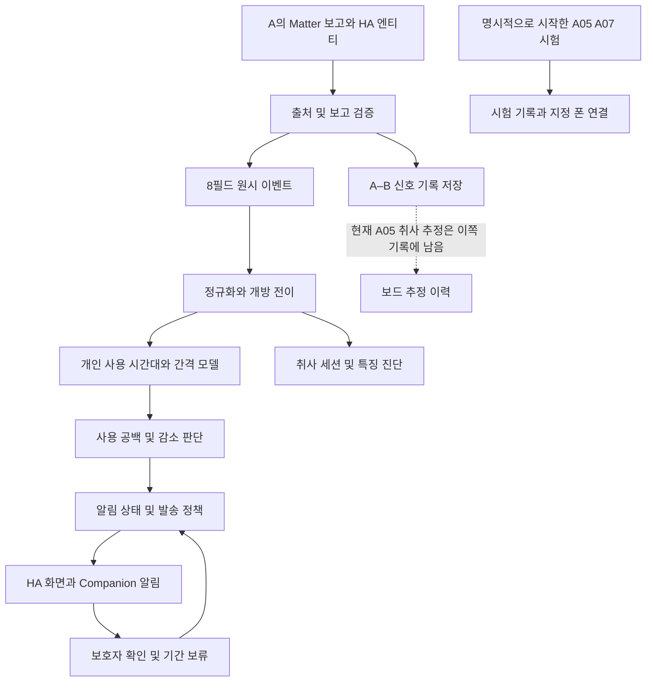
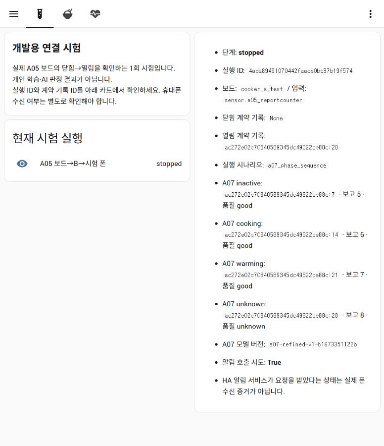
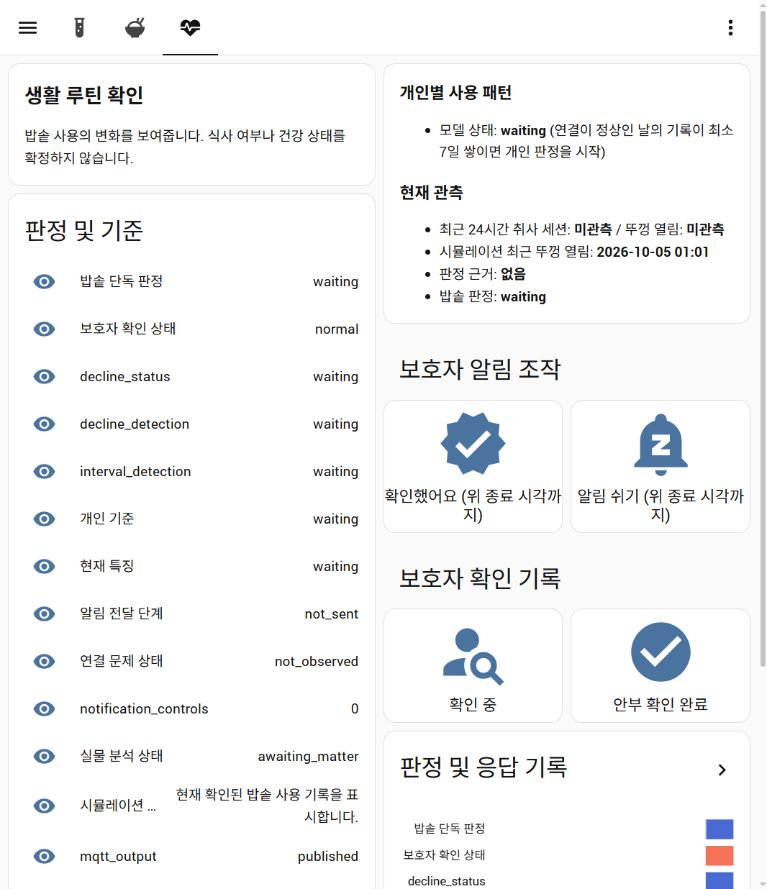
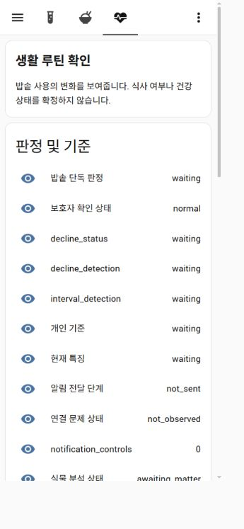
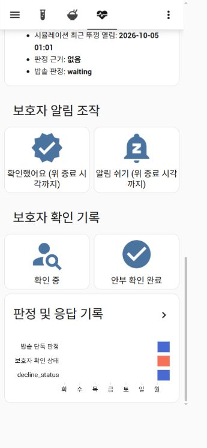

# B 서비스 구현과 검증 종합 점검 보고서

2026년 10월 5일 · 검토자 Codex · 수신자 A 및 프로젝트 담당자

> **2026-10-06 후속 상태:** 이 문서의 F01~F10 재현·줄번호·판정은 `7f3e206` 당시의 점검 기록이다. `112db151` 기준 main에는 F01의 보드 맥락→행동 분류/근거 연결과 F02~F09의 주요 코드 보완이 병합됐다. F01은 사용자가 선택한 범위대로 설명·분류에 반영하며 알림 발송 여부/시각을 바꾸지 않는다. 이번 후속 변경은 F07의 만료 보류 선택 제거·선택 유지·보호자/진단 화면 분리, F10의 동일 가구일·동일 상태 관리 규칙을 거친 고정 24시간 **첫 요청** 비교를 추가한다. 아래 원래 결함 표는 역사적 증거로 보존한다. 현재 구현과 실기 경계는 [구현 상태](../IMPLEMENTATION_STATUS.md)와 [평가 기록 규약](../개인화_평가_기록_규약.md)을 함께 본다. 실제 HA에서 병합본의 다중 사건·보류 화면, 운영 알림 클릭, 저장 실패/재시작, 장시간 만료는 이 후속 변경만으로 확인되지 않았다. 합성 첫 요청 비교는 방해금지·보류·폰 전송을 포함하지 않아 제품 성능 승인이 아니다.

## 1 결론과 판단 범위

**B 담당 서비스에는 수집부터 개인화 판단과 알림까지 작동하는 기반이 있다. 그러나 기존 테스트 통과와 A07 보드 연결 성공만으로 합의한 보호자 서비스가 완성됐다고 승인하기는 어렵다.** 입력 출처 검증, 시험 데이터 격리, 관측 공백 처리, 알림 재시도 및 재시작 복구에는 구체적인 구현과 회귀 시험이 있다. 반면 취사·보온 맥락의 행동 연결, 보호자 화면과 조작, 출력 계약의 근거 추적, 일부 장기 정책에는 누락이나 불일치가 확인됐다.

이 보고서는 사람의 역량이나 성실성을 평가하지 않는다. 현재 main에 합쳐진 **B 책임 범위의 결과물**을 합의사항과 대조한다. A와 B가 함께 수정한 통합 코드도 포함하므로 모든 줄의 작성자를 B라고 단정하지 않는다. 제품 코드는 수정하지 않았다.

| 점검 축 | 판단 | 핵심 근거 |
|---|---|---|
| 요구사항 대조 | 부분 구현 | 기본 사용 패턴 경로는 있으나 맥락·출력·사용자 조작에서 공백 |
| 대표 생활 시나리오 | 주요 기본 동작 통과 및 예외 결함 확인 | 기존 184개 테스트, 새 7개 생활 시나리오, 별도 결함 재현 |
| 모델 평가 | 합성 자료 안에서 검증 가능하나 실생활 유용성 미확정 | 기존 192가구 실험 재실행, 별도 생성 8개 시간표, 고정 규칙 비교 |
| 운영 신뢰성 | 정상적인 실패 처리 기반은 있으나 보완 필요 | 재시도·불명확 결과·중복 처리 통과, 저장 승인 순서 및 선택 모드 만료 문제 |
| 실제 사용자 흐름 | 설치된 화면 확인 및 기능 공백 확인 | HA 실화면과 모바일 폭 캡처. 이번 검토에서 실물 폰 푸시·외부망·버튼 종단 시험은 미실행 |

권고는 **센서 도착 전 개발 기준으로 main을 유지하되, 운영 완료 승인은 보류**하는 것이다. 10절의 우선 보완 작업과 11절의 현장 시험을 완료한 다음 다시 승인한다. 기존 구현을 전면 폐기하거나 AI를 새로 만드는 방향은 권하지 않는다.

## 2 기준 버전과 증거 수준

검토 기준 커밋은 `7f3e206def3f98bfdb3a8c25dc3d4f2ca64cfc90`이다. Python 3.14.6에서 저장소 루트의 테스트를 실행했다. 검토 시작 때 `docs/hardware/README.md`, `docs/planning/A_개인_실행계획.md`가 수정 중이었고 A08 문서와 이미지 폴더가 미추적 상태였다. 이 작업물과 `firmware/`는 수정·이동·스테이징하지 않았다. 검토 결과와 증거만 새로 추가했다.

설계 기준은 역할 분담, 기능 입출력 정의서, 팀 상세설계 합의안, 분석 알림 정책, A–B 데이터 계약, 분석결과 출력 계약, 통합시험 계획이다. 기존 구현 현황 문서와 과거 테스트 기록은 참고 자료로만 읽고 최신 실행 결과와 구분했다. 오래된 PDF의 보드 분석 구조를 현재 B 구현의 기준으로 삼지 않았다.

이 보고서의 상태 용어는 다음과 같다.

- **실행 확인:** 현재 소스를 실행해 관찰한 결과. 가짜 HA 객체·전송 함수 사용 여부를 명시한다.
- **코드 확인:** 실제 함수·호출 경로를 읽고 확인한 구현. 실제 장비 동작까지 보증하지 않는다.
- **화면 확인:** 이번 점검에서 실제 설치된 HA 화면을 직접 보고 캡처한 결과.
- **기존 실기 기록:** 앞선 A07 현장 검증 문서의 기록. 이번에 재실행한 실적으로 세지 않는다.
- **미검증:** 필요한 장비·입력·기간 또는 사용자 조작 증거를 이번 점검에서 확보하지 못한 항목.

실제 HA 화면에 접근해 시험 실행이 `stopped`인 것과 실물 분석이 `awaiting_matter`인 것을 확인했다. 이는 보드/센서가 현재 정상 운영 중이라는 증거가 아니다. 설치된 HA 파일 전체의 커밋 및 해시는 이번에 대조하지 않았다. 소스 분석과 화면 관찰은 각각의 증거로 표시한다.

## 3 B가 만든 구조



활성 모델은 `domain/personal_model/engine.py`의 `PersonalUsageModel`이며 기본 실행은 HA 내부 통합이다. 운영 모델 생성 함수는 `domain/personal_model/__init__.py`의 `operating_usage_model()`이다. 최근 10일 시간대와 과거 28일 기준이 75분 이상 달라질 때만 최근 시간대를 적용하도록 설정돼 있다. 이전 `PersonalBaselineEngine`, `RuleDetector`, 세션 특징 기반 코드는 남아 있으나 현재 개인화 알림의 주 판단 경로가 아니다.

| 계층 | 주요 코드 | 실제 역할 |
|---|---|---|
| 보드 입력 검증 | `service/a05_snapshot_input.py`, `service/a05_contract_records.py` | 플랫폼·식별자·경로·스키마·순번·품질 검증, 신호별 계약 기록 |
| 원시 경계 및 정규화 | `inputs/base/contracts.py`, `domain/events/normalizer/core.py` | 원시값을 행동 사건으로 변환. 최초·복구 snapshot은 새로운 개방에서 제외 |
| 개별 패턴 | `domain/personal_model/engine.py` | 60분 묶음, 예상 창, 사용 확률, 간격, 장기 감소 |
| 판단 연결 | `service/analysis_policy.py`, `service/ha_analysis_flow.py` | 시간대·간격·추세 판단을 각각 알림 상태 관리에 전달 |
| 알림 | `workflow/`, `service/ha_notification_flow.py` | 사건 상태, 보류, 중복, 재시도, 불명확 전송 결과 |
| 기록 | `service/ha_journal.py`, `service/observations.py` | 정규화 관측·계약 기록·서비스 기록 파일 및 보존 |
| 화면 및 조작 | `service/ha_dashboard.py`, `service/ha_caregiver_commands.py` | 화면 센서, 확인/보류 서비스, 모바일 액션 |
| 선택적 독립 실행 | `service/standalone.py`, `service/runner.py` | MQTT 입력을 별도 Python 작업자에서 분석 |

### 취사와 보온을 쓰는 범위

A05 수신 콜백은 신호별 계약 기록을 저장한 뒤, 접점 품질이 정상일 때 `A05SnapshotInput`을 거쳐 개방/연결 원시 사건을 만든다. `cooker_phase`를 개방 행동에 붙이거나 이를 근거로 예상 사용 안내를 조정하는 연결은 현재 경로에 없다. 개인 모델의 `observe()`도 `device_online`, `device_offline`, `lid_opened`만 소비한다.

보드 추정을 검증된 식사나 확정 행동으로 자동 승격하지 않는 경계는 적절하다. 하지만 합의한 **보온/최근 취사 맥락을 사용 행동에 붙이는 기능**까지 생략해야 하는 것은 아니다. 먼저 품질·시각·추정 버전을 보존한 맥락을 기록과 상세 화면에 연결하고, 알림 보류에 영향을 주는 변경은 별도 비교 시험으로 검증하는 것이 적절하다.

## 4 요구사항별 구현 대조

아래의 통과는 해당 소프트웨어 조건에 한정한다. 표 전체를 실물 운영 승인으로 해석하지 않는다.

| 번호 | 합의한 기능 | 현재 상태와 근거 | 판단 |
|---|---|---|---|
| R01 | 입력 어댑터는 원시값만 전달 | 원시 8필드 경계와 정규화 계층 분리 유지 | 구현 확인 |
| R02 | 출처·품질을 검증하고 시험 입력을 실물 학습과 분리 | verified live/test 경로 분리. A05 테스트와 실제 화면에서 시험 경로 확인 | 실행 확인 |
| R03 | 최초/복구 상태를 새 개방으로 세지 않음 | normalizer 및 A05 연속성 테스트 통과 | 실행 확인 |
| R04 | 첫 개방부터 60분 고정 묶음 | 일반 경계 테스트 통과. 단절을 사이에 둔 묶음은 분리되지 않음 F03 | 부분 구현 |
| R05 | 보온·최근 취사 맥락을 행동에 연결 | A05 계약 기록은 있지만 활성 행동/개인 판단으로 맥락이 전달되지 않음 F01 | 부분 구현 |
| R06 | 초기 일반 기준 및 선택적 생활 시간 입력 | 약한 초기값, 서비스 기반 시간·요일 입력, 초기 설정 보존 테스트 존재 | 코드와 테스트 확인 |
| R07 | 자료 부족과 개인화 상태 구분 | 개방 0회여도 연결 일수만 충족하면 personalized 표시 F04 | 불일치 |
| R08 | 개인 시간대·요일·생활 이동 반영 | 운영 설정과 회귀 테스트 확인, 독립 시간표 시험 통과 | 합성 범위 확인 |
| R09 | 규칙형은 서로 다른 두 예상 창 누락 | 36시간 안 두 후보, 정상 사용/지연/미사용 시나리오 확인 | 실행 확인 |
| R10 | 불규칙형은 유효 간격과 유예 사용 | 경험적 95분위 + 2시간, 관측 공백 제외 테스트 | 실행 확인 |
| R11 | 감소는 장기 비교와 반복 확인 | 7일 대 이전 최대21일, 최근5/이전10 유효일, 3일 연속 판단 | 실행 확인 |
| R12 | 지속 감소 재안내 | 관리자에는 7일 설정이 있으나 모델이 지속 상태를 전달하지 않음 F05 | 경로 결함 |
| R13 | 다른 활동은 제한적 보류, 미설치도 기본 분석 유지 | simulation 전용, 30분 단위 최대2시간, live 적용 차단 테스트 | 합성 범위 확인 |
| R14 | 야간 보류 및 해소된 알림 폐기 | 야간 경계·복구·두 실행 모드 비교 테스트 통과 | 실행 확인 |
| R15 | 예약/야간 취사 맥락 시험 | 기존 T09는 야간 발송 테스트이며 예약/취사 완료 맥락 전체를 시험하지 않음 | 부분 검증 |
| R16 | 중복 방지·실패 재시도·불명확 결과 구분 | DeliveryLedger 및 HA/worker 회귀 시험 통과 | 실행 확인 |
| R17 | 확인·기간 보류·취소·만료·재시작 유지 | 백엔드 기능 존재. 저장 전 accepted와 화면 취소/선택 공백 F06/F07 | 부분 구현 |
| R18 | 동시 공백·감소 판단을 보호자가 처리 | 두 사건은 존재 가능하나 기본 확인 버튼은 정확히 하나만 허용 F07 | 불일치 |
| R19 | 결과 만료 및 재시작 초기 상태 | HA 내부 타이머·MQTT expiry 테스트 통과. worker 수신 화면은 만료 우회 F09 | 모드별 차이 |
| R20 | 판단별 근거 ID·다음 평가·신호 제한 전달 | 빈 배열/null 고정, 이유 코드도 계약과 다름 F08 | 부분 구현 |
| R21 | 관측90일·서비스180일 보존 | 파티션 및 삭제 코드, 경계 테스트 존재. 실제180일 운영은 미검증 | 소프트웨어 확인 |
| R22 | 폰 푸시에서 해당 상세 화면 진입 | 개발용 시험은 링크 제공. 운영 알림 전송에는 링크 없음 F02 | 부분 구현 |
| R23 | 요약→상세·한국어 근거·보호자 사용성 | 설치 화면은 내부 상태를 많이 노출하며 실물/시뮬레이션이 함께 보임 F07 | 보완 필요 |
| R24 | 고정 규칙과 개인화의 동일 자료 비교 | 비교 도구 있음. 일 단위 후보와 사건별 발송 지표 차이, 제한된 합성 조건 | 부분 검증 |
| R25 | 배포 및 복원 안내 | HA 번들 코드·검사·설치 문서 있음. 실제 새 환경 재설치/복원은 이번에 미실행 | 부분 검증 |
| R26 | 실제 폰·외부망·24시간 운영 | 과거 A07 시험 폰 수신 기록 존재. 전체 운영 흐름 실물 재검증 필요 | 미완료 |

핵심 합의 참조: `docs/planning/분석_알림_정책.md` 2·3·5·7·10절, `docs/contracts/분석결과_HA_휴대폰_출력계약.md` 2·4·5·7절, `docs/planning/설치_운영_통합시험_계획.md` T08~T20.

## 5 대표 생활 시나리오 실행 결과

### 기존 시험의 재실행

`python -m unittest discover -s tests -v` 결과 **184개 전부 통과**, 실행 시간 22.567초다. 기존 테스트 전체에는 현재 활성 경로뿐 아니라 이전 기준선/진단 경로의 시험도 포함된다. 따라서 184라는 숫자가 184개 사용자 요구사항 또는 184개 실기 시험을 뜻하지 않는다.

`tools.run_software_matrix`의 T08~T13, T17, T20 **8개 묶음이 passed**다. 이 도구는 기존 단위 테스트를 묶어 실행하고 2가구 합성 평가를 추가한다. T17의 합격 조건은 성능 임계값이 아니라 `eligible_days`가 존재하는지다. **passed는 평가가 실행됐다는 뜻이며 정확도 합격 판정이 아니다.** T09 역시 예약/취사 정보를 소비하는지를 검사하지 않는다.

`tools.simulate_notification_flow`는 학습 7일 → 첫 공백 보류 → 다음 공백 요청 → 확인 → 사용 재개 → 재시작 복원을 가짜 전송 함수와 임시 상태 파일에서 재현했다. 실제 폰 전송은 없다.

### 검토자가 추가한 생활 시나리오

운영 모델 생성 함수와 공유 판단 연결부를 사용했다. 기본 이력은 21일간 08시·18시 사용, 이후 3일을 1분 간격으로 평가했다. 개방은 정상 수용된 정규화 사건으로 입력했다. 발송은 가짜 성공 처리이며 야간/모바일 전송 계층은 이 시험의 대상이 아니다. 단절·외출·초기 학습 상태는 별도 조건으로 바꿨다.

| 시나리오 | 입력과 기대 | 실제 관찰 | 판단 |
|---|---|---|---|
| 정상 사용 | 기존 08시·18시 유지 | check_required 0, 첫 안내 요청 0 | 통과 |
| 일시적 지연 | 두 사용을 각각 90분 늦춤 | 후보0, 요청0 | 이 지연 조건 통과 |
| 두 기회 미사용 | 개방 중단, 연결은 유지 | 첫날 약20시03분에 첫 요청, 이후 같은 사건의 재안내 | 기본 경로 통과 |
| 외출 | 미사용 상태에서 외출 표지 | 생활 공백 후보0, 요청0 | 통과 |
| 관측 단절 | 미사용 구간 전체 offline | 생활 공백 후보0, 요청0 | 통과. 연결 문제 안내는 별도 기존 시험에서 확인 |
| 사용 재개 | 첫날 미사용 뒤 다음날08시 실제 개방 | 기존 사건 auto_resolved. 이후 다시 두 창 누락 시 새 사건 | 통과 |
| 초기 기록 부족 | 이전 이력 없이 3일 사용 | 생활 공백 후보0, 요청0 | 통과 |

추가 경계 재현에서는 정상 개방 두 번 사이에 단절·복구를 넣었을 때 정규화기는 실제 개방 2회를 전달했지만 개인 모델은 사용 묶음 1개로 합쳤다. 단순한 정상 예시 통과로 경계 조건까지 승인할 수 없는 사례다.

원문 증거: [새 시나리오 및 결함 재현 결과](b-review-20261005/audit-probes.json), [HA 연결부 추가 재현](b-review-20261005/extra-probes.json), [기존 테스트 로그](b-review-20261005/unit-tests.log).

## 6 모델 평가의 재현과 한계

### 기존 두 가구 평가

같은 24개 유효 가구일과 4개 평가 제외 가구일에서 다음 결과가 나왔다.

| 출력 | TP | FP | FN | TN | 읽는 방법 |
|---|---:|---:|---:|---:|---|
| 개인화 내부 후보 | 6 | 4 | 0 | 14 | 판단 후보가 발생한 날짜 기준 |
| 개인화 첫 알림 요청 | 3 | 0 | 3 | 18 | 같은 사건의 중복 억제가 반영되는 날짜 기준 |
| 고정24시간 후보 | 6 | 2 | 0 | 16 | 해당 날짜 말의 마지막 사용 경과 기준 |

이 평가에서는 개인화 내부 후보가 고정 기준보다 오탐 가구일이 많았다. 첫 알림 요청은 줄었지만, 날짜별 FN에는 이미 전날 안내한 지속 사건이 포함될 수 있다. **이 세 행을 그대로 “실제 알림 정확도 비교”로 읽으면 안 된다.** 동일 사건 정의, 같은 중복·야간 정책, 같은 지연 측정 원점으로 비교해야 한다.

### 192가구 합성 재평가

48개 seed × 아침1회/하루2회 × 안정/점진적 이동의 192개 합성 가구를 기존 코드 그대로 재실행했다. 학습 이력 21일 이후 14일 평가, 두 예상 개방을 제거한 사건을 가구당2개 넣고 1분 간격으로 평가한다. 이 실험의 `current`는 **이전 28일 시간대 설정**, `gated`가 **현재 운영에 채택된 조건부 최근 시간대 설정**이다. 이름 때문에 이전 설정을 현재 배포 설정으로 오해하면 안 된다.

재실행 결과 JSON은 저장소의 기존 `ai/in_scope_adaptation_holdout_result.json`과 **객체 전체가 정확히 일치**했다. 단순히 요약 숫자만 비슷한 수준이 아니다.

| 지표 | 이전 설정 current | 운영 설정 gated |
|---|---:|---:|
| 합성 가구 | 192 | 192 |
| 사건 포착 | 357 / 384 | 357 / 384 |
| 채점 창 안에서 미포착 | 27 | 27 |
| 위 미포착 중 일찍만 요청 | 12 | 12 |
| 포착률 | 92.97% | 92.97% |
| 포착 사건의 지연 중앙값 | 1.82시간 | 1.81시간 |
| 포착 사건의 지연90분위 | 2.26시간 | 2.26시간 |
| 관련 없는 요청이 있는 정상 가구일 | 127 / 1,728 | 121 / 1,728 |
| 위 정상 가구일 비율 | 7.35% | 7.00% |

운영 설정의 합성 포착률 가구 재표집95% 구간은90.36~95.31%, 정상일 요청 비율은5.84~8.22%다. 설정 변경에 따른 요청 비율 차이의 짝지은 재표집 구간은 -0.64~-0.12%포인트다. 이는 같은 생성 가정 안의 변동 범위이며 실제 가구 모집단에 대한 신뢰구간으로 일반화하지 않는다. 개선은 정상 가구일6일 감소로 작고, 포착 수는 그대로다. 7% 역시 실제 서비스의 오경보율로 표시하면 안 된다.

원문 증거: [192가구 재실행 결과](b-review-20261005/holdout-rerun.json), [실행 로그](b-review-20261005/holdout.log).

포착 지연의 원점은 **두 번째 제거된 예상 개방 시각**이다. 첫 미사용이나 마지막 실제 사용 이후의 지연이 아니며, 실물 폰 도착 시간도 아니다. 이 재생은 내부 요청 시점을 점수화하며 야간·전송 실패·Companion 수신을 포함하지 않는다. `early_request_only`는 두 번째 누락 전에만 요청한 사건으로, 전혀 요청하지 않은 사건과 구분해야 한다.

### B의 생성기를 사용하지 않은 추가 비교

검토자가 별도 생성기로 07시1회, 19시1회, 07/19시2회, 07/12/19시3회의 4개 시간표를 만들었다. 각 시간표에 안정 및 매일25분 이동 조건을 적용해 총8개를 비교했다. 시각 오차는 ±20분, 이력21일·평가9일, 미리 정한 두 개방을 제거했다. 현재 운영 모델과 “마지막 개방 후24시간 초과 시 공백당1회” 기준에 동일 입력을 주었다. 설정을 결과에 맞춰 재탐색하지 않았다.

| 시간표 | 조건 | 개인화 요청 수 | 고정24시간 요청 수 | 개인화 첫 요청 지연 |
|---|---|---:|---:|---:|
| 07시1회 | 안정 | 1 | 4 | 2.033시간 |
| 07시1회 | 이동 | 1 | 5 | 0.800시간 |
| 19시1회 | 안정 | 1 | 4 | 2.000시간 |
| 19시1회 | 이동 | 1 | 6 | 0.767시간 |
| 07/19시 | 안정 | 1 | 1 | 1.700시간 |
| 07/19시 | 이동 | 1 | 1 | 0.883시간 |
| 07/12/19시 | 안정 | 1 | 1 | 1.967시간 |
| 07/12/19시 | 이동 | 1 | 1 | 1.150시간 |

총 요청은 개인화8회, 고정24시간23회다. 개인화8개 모두 두 번째 제거 개방 뒤24시간 내 요청이 있었다. 하지만 이것을 고정 규칙의 사건 포착이 낮다는 근거로 삼지 않는다. 고정 규칙은 두 번째 누락보다 먼저 알리는 경우가 있어 같은 채점 창 밖으로 나간다. 이 비교는 **단순24시간 경계가 하루1회 사용자에게 시각 흔들림만으로 자주 요청할 수 있다는 사례**이며, 두 창 정책에 맞춘 작은 자료에서 개인화의 기능상 이점을 보여준다. 실생활 일반화나 통계적 우월성 증거는 아니다.

원문 증거: [독립 시간표 결과](b-review-20261005/independent-cases.json), [재현 생성기](b-review-20261005/independent_cases.py).

### 평가 설계에서 잘한 점

학습·미래 구간을 시간순으로 나누고 별도 seed 가구를 평가한다. 개선 후보를 무조건 운영에 적용하지 않고 정상일 요청 증가를 확인해 탈락시킨 기록이 있다. 가구 단위 재표집을 사용해 같은 가구의 날짜/사건을 완전히 독립 표본처럼 취급하지 않으려 한 점도 적절하다. 합성 결과를 실측 정확도로 부르지 않는 경계가 문서와 코드에 있다.

### 아직 입증되지 않은 점

1. **생성기 편향:** 별도 seed도 같은 시간표·오차·결측 생성 규칙 안에 있다. 192가구는 192명의 실제 노인을 뜻하지 않는다. 연령 필드는 실제 모집단으로부터 추정한 행동 분포가 아니다.
2. **정책과 라벨의 유사성:** 두 기회 누락이라는 정책에 맞춰 정확히 두 기회를 제거한다. 요구사항 재현에는 적합하지만 폭넓은 생활 변화 탐지의 독립 정답은 아니다.
3. **좁은 입력 조건:** 핵심 홀드아웃은 아침1회와 하루2회, 안정/점진적 이동 중심이다. 수면 이동, 간헐적 여행, 장기간 식사 방식 변화, 불규칙 센서 누락과 불규칙 실제 행동의 혼합은 충분히 대표하지 못한다.
4. **모델과 최종 발송의 차이:** 재생 요청에 야간·보류·실패·실물 전달을 모두 적용하지 않는다. 포착률과 지연을 보호자 경험으로 곧바로 옮길 수 없다.
5. **대조군 범위:** 대규모 시간대 적응 실험은 개인화 설정끼리의 비교다. 단순24시간·개인 간격 규칙 등과 동일 최종 발송 정책을 쓴 대규모 비교는 추가 필요하다.
6. **합격 기준:** T17은 평가 결과가 존재하면 통과한다. 오탐/누락/지연의 제품 합격 기준은 별도로 정해야 한다.

의도적 조작이나 미래 자료 누출을 확인했다는 결론은 아니다. 이번에 확인한 시간순 코드와 seed 분리는 합리적이다. 다만 합성 생성 가정에 의존하는 범위가 크다는 뜻이다.

## 7 운영 신뢰성 점검

| 조건 | 이번에 확인한 증거 | 판정과 한계 |
|---|---|---|
| 중복·역순 개방 | 개인 모델 및 HA/worker 회귀 시험 | 오래된 개방으로 학습/사건 해소하지 않는 조건 통과 |
| 초기 캐시·단절 후 snapshot | A05/HA 시험 | 새로운 실제 개방으로 세지 않음 |
| 보고 순번 공백 | A05 시험 | 마지막 확인 보고 직후부터 관측 공백 처리 |
| 접점 오류 및 다른 신호 | 콜백의 접점 품질 필터, 계약 기록 검사 | 접점 품질 오류를 정상 개방 학습으로 넘기지 않는 코드 경계 확인 |
| 명확한 발송 실패 | DeliveryLedger 시험 | 30초/2분/5분 대기, 최대3회 추가 시도. 실제 HA 주기 실행 때문에 정확한 초에 보내는 것은 아님 |
| 타임아웃·전송 중 재시작 | ledger 및 HA 모의 시험 | uncertain으로 보존하고 자동 중복 재발송 중단 |
| 해소 후 실패 재시도 | HA 시험 | 해소된 사건의 과거 요청 재발송 방지 |
| 야간 보류 중 복구 | quiet/observation 시험 | 이미 해소된 연결/생활 요청 발송하지 않음 |
| 상태 파일 재시작 | worker 임시 파일 및 Fake HA 시험 | 사건·발송·보류 복원. 실제 HA 디스크 장애 복구는 별도 |
| 보호자 명령 저장 | 직접 콜백 계측 F06 | accepted가 영속 저장보다 먼저 나감 |
| 상태 만료 | 내부 모드 expiry 테스트, 외부 수신 추가 재현 F09 | 내부 모드 통과, 외부 모드 해당 화면 엔티티 실패 |
| 기록 보존 | ObservationJournal 경계 시험 | 삭제 계산 확인. 실제90/180일 누적·용량 한계는 미검증 |
| 기록 쓰기 실패 | `HAJournal` 코드 | 예외를 로그로 남기지만 기록 실패가 사용자 출력 품질/상태로 올라오는 연결은 확인되지 않음 |
| 실제 네트워크·전원 장애 | 이번에 장애 유발하지 않음 | 미검증. 실운영 중 네트워크나 전원을 끊지 않음 |
| 24시간 연속 동작 | 해당 시간 관측 없음 | 미검증. 빠른 재생을24시간 실운영으로 계산하지 않음 |

HA 테스트는 `FakeHass`와 대체 저장소/서비스를 사용한다. 특히 테스트의 `Store.async_delay_save()`는 즉시 메모리 사본을 잡으므로 실제1초 지연 저장 중 장애 창을 재현하지 않는다. 이것이 기존 저장 테스트 통과와 F06이 동시에 성립하는 이유다.

## 8 실제 화면과 보호자 흐름

설치된 HA에서 대시보드를 직접 열고 기본 폭과390×844 모바일 폭으로 확인했다. 브라우저 폭을 바꾼 확인이며 실제 Android/iOS Companion 앱 시험은 아니다. 알림·보류·확인 버튼을 실환경에서 실행하지 않아 운영 상태를 변경하지 않았다. 기능 경계는 앞 절의 가짜 HA 재현으로 확인했다.

### 화면 1 개발용 보드 연결 결과



기존 실행 ID와 네 단계, 모델 버전, `stopped`가 보인다. 실제 폰 수신과 HA 수락을 구분하는 문구는 적절하다. 다만 A07 시나리오인데 화면 소개는 닫힘→열림 시험이고, `unknown` 단계의 기록을 “열림 계약 기록”으로 표시하는 등 시험 화면 문구는 정리가 필요하다. 이것은 운영 모델의 검증 화면이 아니다.

### 화면 2 현재 밥심 상태



실물 분석은 `awaiting_matter`, 입력 준비는 `connection_unverified`인데 보호자 확인 상태는 `normal`이다. `normal`은 내부 사건이 없다는 뜻일 수 있지만 보호자가 정상 생활로 읽을 가능성이 있다. 시뮬레이션 상태와 시험용 통신 입력도 같은 운영 상태 영역에 노출된다. 데이터 저장/학습 경로가 실제로 섞였다는 증거는 아니며 **표시 맥락의 혼동** 문제다.

### 화면 3 모바일 첫 화면



첫 화면에 기다리는 내부 센서 이름과 영문 상태가 길게 나온다. `decline_status`, `interval_detection`, `not_observed` 등의 의미를 보호자가 추측해야 한다. 최근 실물 사용·현재 판단 가능 여부·지금 할 일을 우선 보여주는 합의한 요약 흐름과 차이가 있다.

### 화면 4 보호자 조작



버튼 크기는 확보됐지만 “위 종료 시각” 입력이 버튼과 떨어져 있다. “확인했어요”와 “확인 중/안부 확인 완료”의 차이 설명이 부족하다. 보류 취소와 사건 선택 UI는 제공 YAML에서 찾을 수 없으며 현재 화면에도 없다. 성공/실패 결과 센서는 코드에 있지만 이 기본 대시보드 목록에는 표시되지 않는다.

접근성 측면에서는 브라우저 접근성 트리에 조작 버튼4개가 이름 없는 `button`으로 나타났다. 스크린리더 이름 매핑은 추가 확인이 필요하다. 스크린샷만으로 색 대비·키보드 조작·스크린리더 준수 여부를 확정하지 않는다.

### 사용자 단계별 확인 범위

| 단계 | 확인 결과 |
|---|---|
| 초기 생활 시간 입력 | HA 서비스는 있음. 보호자용 입력 폼은 기본 대시보드에서 확인되지 않음 |
| 현재 상태 이해 | 실화면 확인. 데이터 미수신과 정상 사건 상태 표현의 구분 보완 필요 |
| 실제 생활 안내 수신 | 가짜 전송 경로 실행. 이번에 실물 폰으로 운영 안내를 보내지는 않음 |
| 알림 눌러 상세 보기 | 시험 알림 링크는 있음. 운영 알림 payload에는 링크가 없음 F02 |
| 확인 기한 선택 및 적용 | 입력과 버튼 존재. 사건2개일 때 오류 재현, 영속 저장 승인 순서 문제 |
| 알림 쉬기 취소 | 백엔드 서비스만 있고 기본 UI 경로 부족 |
| 외부망에서 같은 동작 | 이번에 미실행. 기존 A07 기록도 외부 상세 접근 완료를 입증하지 않음 |

## 9 확인한 결함과 수정 후 합격 조건

아래 F01~F10은 각각 근거가 있는 구현/계약 공백이다. 센서 도착을 기다리지 않고 처리할 수 있는 항목과 실기 확인이 필요한 항목을 구분했다. 우선순위는 운영 사용 전에 먼저 고칠 항목을 앞에 둔 것이며 실사용 사고가 발생했다는 의미는 아니다.

### F01 취사와 보온 맥락이 활성 사용 행동으로 연결되지 않음

- **근거:** `service/a05_snapshot_input.py:88` 이후, HA 통합 `__init__.py:560` 이후, `domain/personal_model/engine.py:242`, `service/ha_cooker_events.py`.
- **관찰:** A05 계약 신호는 저장하지만 모델에는 접점/연결만 전달한다. 취사 세션과 특징은 별도 진단 경로다.
- **영향:** 보온·최근 취사 맥락을 붙이기로 한 행동 설명과 상세 이력이 구현되지 않는다. A07 네 상태 시험 성공이 이 맥락 활용을 검증하지 않는다.
- **권고:** 우선 사용 행동에 시각·품질·추정 버전과 함께 맥락을 연결한다. 알림 보류 변경은 별도 옵션과 비교 시험으로 검증한다. unknown 때문에 정상 접점 기록을 버리지 않는다.
- **합격 조건:** 같은 개방에 warming/recent cooking/unknown을 각각 주었을 때 사용 사건 자체는 유지하고 맥락·추정 여부·근거가 다르게 저장/표시된다. 기존 원시8필드 계약과 시뮬레이터에 판단을 추가하지 않는다.

### F02 운영 모바일 알림에 상세 화면 링크가 없음

- **근거:** `service/ha_notification_transport.py:36`의 실제 payload는 title/message/actions만 포함한다. `service/runner.py`의 live 전송은 title/message만 보낸다. 반면 `service/ha_a05_connection_test.py:165`는 시험용 url/clickAction을 설정한다.
- **재현:** 가짜 notify 함수로 실제 `send_mobile()`을 호출해 인자를 기록했다. 운영 payload에는 상세 경로가 없었다. [재현 결과](b-review-20261005/audit-probes.json)의 `control_and_mobile` 참조.
- **영향:** 시험 알림 클릭 성공을 운영 알림 클릭 성공으로 일반화할 수 없다. 앱이 어느 화면을 여는지는 폰 설정에 따라 달라질 수 있으므로 “반드시 열리지 않는다”고까지 단정하지 않는다.
- **권고:** 저장한 detail_path를 두 운영 전송 경로의 플랫폼별 링크 필드에 연결한다.
- **합격 조건:** 실제 운영 판단으로 생성한 안내가 올바른 상세 화면/사건으로 연결되고, 내부망과 외부망에서 각각 확인된다. 합성 운영 테스트는 지정 시험 대상과 격리해 수행한다.

### F03 단절을 사이에 둔 개방이 같은 사용 묶음으로 합쳐짐

- **근거:** `domain/personal_model/engine.py:273`의 묶음 함수는 시간 차이만 사용한다. 분석 정책2절은 중간 오류·단절이 연속성을 끊도록 정한다.
- **재현:** 08시 개방 →08시10분 offline →08시20분 online →닫힘 기준 설정 →08시30분 실제 개방. 원시 정규화 경로에서 개방2회가 나오지만 모델 묶음은08시1개다.
- **영향:** 복구 이후 별도 행동이 이전 행동에 합쳐져 사용 묶음 수와 감소 비교 근거가 달라질 수 있다.
- **권고:** 묶음에 연속 관측 구간 경계를 반영하고 재시작 후에도 경계를 복원한다.
- **합격 조건:** 같은 연속 구간 안의60분 규칙은 유지하되 단절을 가로지르는 두 개방은 별도 묶음이다. 복구 snapshot 자체는 개방이 아니다.

### F04 사용 기록이 없어도 개인화 완료처럼 표시

- **근거:** `domain/personal_model/engine.py:530`의 ready는 예상 창 관측일 충족으로 결정한다. `service/output.py:49`는 이를 personalized로 바꾼다.
- **재현:** 연결만8일 유지하고 뚜껑 개방은0회. profile.ready=true, output.learning=personalized가 나왔다.
- **영향:** 대상자의 사용 패턴을 배울 자료가 없는데 개인 기준이 확보된 것처럼 보인다. 이 조건에서 오경보가 실제 발송됐다는 결과는 아니다.
- **권고:** 연결 충분성, 사용 표본 충분성, 선택적 초기 기준을 분리한다. 합의 정책의 유효 사용일 기준을 명확히 확정하고 insufficient/collecting/personalized에 연결한다.
- **합격 조건:** 연결8일·개방0회는 부족 상태이며, 선택적 초기 기준에 의한 판단은 개인 학습 판단과 화면에서 구분된다.

### F05 지속되는 장기 감소의 7일 재안내가 발생하지 않음

- **근거:** `domain/personal_model/engine.py:650`은 trend_active로 바뀌는 순간에만 check_required를 반환한다. 이후 지속 감소는 None이다. 상태 관리자에 있는7일 reminder 설정에 후속 감소 평가가 도달하지 않는다.
- **재현:**21일간 하루2회 →21일간 하루1회, 계속 정상 관측. 8월29일 첫 감소 요청1회, 9월11일까지 trend_active=true인데 추가 재안내0회. 가짜 성공 처리를 적용했다.
- **영향:** 장기 감소가 지속돼도 정책 문서의7일 재안내가 실행되지 않는다.
- **권고:** 활성 추세를 주기적으로 재평가/전달하고 최신 자료 충분성·보류·야간을 통과한 뒤 재안내한다.
- **합격 조건:**7일 전0회,7일 도달 후1회 재안내, 같은 날 중복0회. 회복/단절/보류 중에는 발송하지 않는다.

### F06 보호자 조작의 accepted가 저장 완료보다 먼저 표시됨

- **근거:** `service/ha_caregiver_commands.py:82`에서 결과를 표시하고105행에서 save_later를 호출한다. 통합의 save_later는 `async_delay_save(..., 1)`이다.
- **재현:** 실제 핸들러를 가짜 HA와 연결해 `notification_control_result=accepted → save scheduled` 순서를 관찰했다. 전원 차단 자체는 수행하지 않았다.
- **영향:** 표시 후 실제 저장 전 종료/저장 실패가 나면 사용자는 적용됐다고 봤지만 복구 후 보류가 사라질 수 있다. 출력 계약7절의 “저장 확인 전에 적용 표시하지 않음”과 다르다.
- **권고:** 영속 저장 성공을 기다린 뒤 accepted를 표시/게시한다. 저장 실패는 rejected 또는 명시적 실패 상태로 반환한다.
- **합격 조건:** 저장 지연 중에는 적용중, 성공 후 accepted, 저장 예외에는 실패. accepted 직후 재시작해도 상태 유지. 실제 지연을 표현하는 대체 Store 시험을 추가한다.

### F07 보호자 화면에서 동시 사건과 보류 취소를 처리하기 어려움

- **근거:** `service/ha_caregiver_commands.py:133`은 active assessment가 정확히1개일 때만 dashboard acknowledge를 허용한다. 기본 `bapsim_lab.yaml`에는 사건 선택·cancel_pause·명령 결과 카드가 없다.
- **재현:** 공백/감소 사건을 동시에 활성화한 뒤 실제 dashboard handler 호출 시 `Acknowledge requires exactly one active assessment` 오류가 났다. 실화면에도 선택/취소 경로가 없다.
- **영향:** 계약상 허용된 동시 판단 상태에서 보호자가 확인 작업을 완료하지 못한다. 이미 설정한 여행 기간을 UI에서 취소하기 어렵다.
- **권고:** 사건별 확인 조작과 현재 보류 목록/취소, 성공·실패/종료 시각을 같은 흐름으로 보여준다. 실물 자료가 없으면 판단 불가를 최상단에 표시한다.
- **합격 조건:** 사건0/1/2개, 보류0/1/복수개, 과거 종료 시각, 저장 실패를 각각 화면에서 명확히 처리한다. 영문 내부 상태와 시뮬레이션 정보는 보호자 요약에서 분리한다.

### F08 출력 계약의 근거와 의미가 충분히 전달되지 않음

- **근거:** `service/output.py:35`~50. evidence_ids=[], next_evaluate_at=null, sensor_issues=[]가 고정이다. reason_codes는 EXPECTED_USE_MISSING 등 내부 대문자 코드를 그대로 복사하지만 계약은 expected_window_missed 등의 어휘를 정의한다.
- **재현:** 실제 출력 생성 함수를 호출한 결과에 같은 빈 값/내부 코드가 확인됐다.
- **영향:** 화면/외부 소비자가 알림을 근거 기록까지 추적하거나 다음 판단 시점과 신호 제한을 설명하기 어렵다. JSON 필드가 존재하는 것만으로 계약 의미가 완성된 것은 아니다.
- **권고:** 안정적인 관측/행동 ID 연결, 이유 코드 변환 또는 계약 버전 변경, 알려진 다음 평가 시점과 신호 품질을 전달한다. null이 정당한 경우와 단순 미구현을 구분한다.
- **합격 조건:** 대표 판단에서 evidence_ids가 저장 기록으로 해석되고, 알려진 오류/미지원 신호가 출력에 반영되며, 이유 코드가 선언한 계약과 일치한다.

### F09 선택적 독립 작업자 모드의 화면이 만료된 결과를 받아들임

- **근거:** `service/ha_mqtt_subscriptions.py:64`의 on_state는 household만 확인한 뒤 `show()`로 전달한다. 내부 모드의 `HADashboard.show_output()`에 있는 valid_until 검증/타이머를 거치지 않는다.
- **재현:**1시간 전에 생성돼 이미 만료된 worker payload를 구독 콜백에 넣었더니 `sensor.bapsim_output_state`에 그대로 표시되고 만료 타이머는0개였다.
- **영향:** worker 모드에서 해당 화면 엔티티가 오래된 판단을 계속 표시할 수 있다. MQTT discovery 센서의 expire_after는 별도 엔티티 경로라 이 수동 상태 표시를 자동으로 보호하지 않는다. 현재 기본 HA 내부 모드에는 동일하게 적용되는 결함이 아니다.
- **권고:** worker 상태도 동일한 만료 표시 함수를 사용하고 스키마·revision·시각을 검증한다. 발표/운영에서 내부 모드만 지원할 경우 선택 모드의 검증 범위를 명시한다.
- **합격 조건:** 이미 만료된 retained payload 거부, 새 결과의180초 뒤 만료, 오래된 revision 재수신으로 현재 결과를 덮어쓰지 않음.

### F10 현황 문서와 시험 이름이 최신 검증 범위를 정확히 설명하지 못함

- **근거:** README/IMPLEMENTATION_STATUS의 과거 미검증·PR 대기 문구, 출력 계약6절의 시험 경로 미제공 문구가 최신 A07 구현과 공존한다. SW matrix의 T09/T17 passed는 해당 요구 전체 완료보다 좁은 의미다.
- **영향:** 사용자가 무엇을 만들었고 어디까지 검증했는지 파악하기 어렵다. 테스트 숫자가 기능 승인처럼 읽힐 수 있다.
- **권고:** 최신 상태 요약 한 곳을 기준으로 삼고 기능별 코드/검증/실기/미완료를 연결한다. 과거 기록은 날짜와 당시 범위를 유지한다.
- **합격 조건:** 문서만 읽어도 운영/시험 경로, 모델 설정, 배포 모드, 실기 완료 범위, 남은 항목이 모순 없이 구분된다.

## 10 센서 도착 전에 권하는 보완 순서

| 순서 | 작업 묶음 | 담당과 완료물 |
|---|---|---|
| 1 | 보호자 조작과 결과 정합성 F02/F06/F07 | B: 운영 링크·저장 승인·사건 선택·보류 취소. A: 지정 시험 폰 확인 지원 |
| 2 | 모델 상태 및 행동 경계 F03/F04/F05 | B: 단절 경계·부족 상태·추세 재안내 회귀 시험과 재현 결과 |
| 3 | 취사/보온 맥락과 근거 출력 F01/F08 | B: 행동 맥락·ID 추적·화면 연결. A: 입력 의미/품질 검토 |
| 4 | 실행 모드 정리 F09 | B: 내부 모드 기준 확정, 외부 모드 지원 시 동일 만료/조작 계약 보장 |
| 5 | 평가 및 인계 문서 F10 | B: 같은 발송 정책의 고정 규칙 비교, 성능 합격 기준, 현재 구현 상태 갱신 |

각 작업은 요구사항 → 실패 재현 → 수정 → 회귀 시험 → 실제 영향 확인을 한 묶음으로 제출하는 것이 좋다. 이번 검토에서는 제품 수정이나 새 정책 적용을 하지 않았다. 특히 취사 중 안내 보류처럼 사용자에게 알리는 시점을 바꾸는 정책은 합의와 비교 자료를 남겨야 한다.

## 11 실제 장비에서 남은 승인 시험

이 목록은 아직 실행하지 않은 시험이다. 아래 결과 없이 “전체 점검 통과”로 발표하지 않는다.

| 시험 | 구체 절차 | 완료 증거 |
|---|---|---|
| 운영 판단과 폰 연결 | 격리된 합성 이력을 운영 정책에 재생해 실제 지정 시험 폰으로1건 전송 | 사건 ID·발송 ID·HA 수락·폰 수신 각각 기록 |
| 상세 링크 | 같은 안내를 내부 Wi-Fi 및 모바일 데이터에서 클릭 | 올바른 가정/사건/근거 화면 도달 |
| 확인 및 보류 | 사건1개/2개에서 확인 기한 설정, 여행 보류·취소·만료 | 성공/실패 화면, 저장값, 재시작 후 유지 |
| 저장 실패 | 별도 시험 환경에서 쓰기 실패/저장 전 종료 재현 | 거짓 accepted 없음, 복구 후 일관성 |
| 네트워크 장애 | HA↔MQTT, 센서↔HA, 인터넷, 분석 프로세스 중단을 따로 시험 | 단절 시각·판단 제한·복구 동작·중복 발송 수 |
| 24시간 운영 | 실제 보고 주기와 배포 버전으로24시간 지속 | 누락/오류/디스크 증가/기동·복구 기록 |
| 실센서 맥락 | 실제 개방·취사·보온·센서 오류와 동시 수집 | 실제 조작 라벨, 극성/단위, 맥락 대응 |
| 실생활 유용성 | 익명 기록과 독립 확인 라벨, 사전 고정한 성능 기준 | 같은 입력·발송 정책에서 오경보·누락·지연 비교 |

폰 화면까지의 검증은 B 혼자 하드웨어 없이 완료할 수 없다. 반대로 F01~F10의 대부분은 센서 도착이나 현장 계정에 의존하지 않고 코드와 합성 입력으로 해결할 수 있다.

## 12 재현 자료와 사용 방법

같은 폴더의 [증거 목록](b-review-20261005/manifest.json)에 기준 커밋, 실행 환경, 파일 해시를 기록했다. 원본 실행 자료는 `local-data/b-review-20261005/`에 남아 있고, 공유 가능한 보고서용 사본을 이 보고서 옆에 묶었다. 계정 토큰·비밀번호·HA 설정 원본은 포함하지 않는다.

저장소 루트에서 실행한다. 기존 증거를 보존하려면 결과 폴더를 새로 지정하거나 검토 스크립트를 별도 폴더에 복사한다. `run_holdout.py`는192가구 재계산으로 시간이 걸린다. 보고서용 스크립트는 실제 서비스나 폰에 연결하지 않는다.

```powershell
python -m unittest discover -s tests -v
python -m tools.run_software_matrix --output local-data/b-review-new/software-matrix.json
python -m tools.simulate_notification_flow
python docs/reviews/b-review-20261005/audit_probes.py
python docs/reviews/b-review-20261005/extra_probes.py
python docs/reviews/b-review-20261005/independent_cases.py
python docs/reviews/b-review-20261005/run_holdout.py
```

스크립트가 실행 확인한 결과와 문서 검토 의견을 구분해서 읽는다. 현재 소프트웨어의 실행 가능성과 몇 가지 좋은 신뢰성 설계는 확인됐지만, **보호자가 일상적으로 사용할 서비스의 완성도는 위 결함 수정과 현장 승인 시험을 거쳐 판단해야 한다.**
